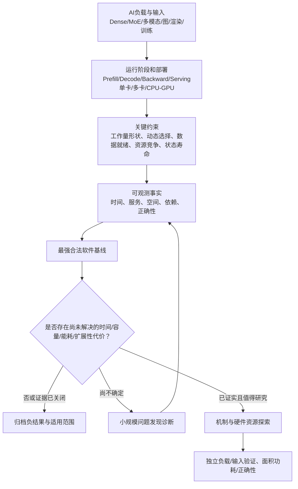

# AI负载体系结构研究：统一问题图谱（V1）

**建立日期：**2026-10-13  
**范围：**推理与训练；LLM、MoE、多模态、推荐、图神经网络、科学计算/3DGS等非LLM AI；单GPU、多GPU、CPU–GPU协同和受限设备。  
**性质：**研究问题地图/可更新的工作底稿。**不是实验结果汇总的替代品，不构成任何新实验、下载、机制开发或GPU授权。**  
**伴随文件：**`AI_WORKLOAD_C16_AWMA_EVIDENCE_INDEX_V1.md`（下文`E-Cxx`、`E-Axx`均链接到该索引）。

## 0. 为什么要统一

这条总主线要回答：**AI程序的模型结构、输入、执行阶段和部署条件如何共同决定GPU瓶颈？在强软件实现之后，还有什么是硬件资源组织必须或可能改善的？**

- **继承C16**：跨模型真实访存采集、算子/模型阶段表征、缓存与执行探索、强编译路径下可观测性的边界。C16当前冻结`635b2f22cbe1bed5ac45de04b258a5f5e9bc6d4f`；最后10个问题0 PRIMARY、0 BACKUP、2个仅暂存问题；这不等于AI体系结构没有问题。
- **继承AWMA**：真实GPU—模拟器校准、地址翻译服务、Pre-L1请求合并、在线稀疏选择、图/动态工作负载、训练梯度与内存生命周期的真实实验。AWMA内部各课题成熟度不同，不应全部概括为“已完成机制”或“没有问题”。
- **纳入文献**：别人在哪个特定负载、机器、软件基线、指标下发现了限制；优先追问未被解决的**约束**，而不是复制论文的优化方法。
- **统一管理而不混淆证据**：训练与推理不共享未经验证的加速结论；源代码所证明的能力不能替代真实性能；模拟器请求数不能直接写成GPU实际stall时间。

### 概念图

这里**时间、容量、能耗、精度/收敛、系统可行性**是不同的目标；不能用某个指标的大幅改善替代其他指标的证明。

## 1. 负载—阶段—约束的横向视角

| 负载/部署 | 关键运行阶段 | 值得观察的变化维度 | 可能限制的资源；不是预先断定的瓶颈 | 当前项目证据 |
|---|---|---|---|---|
| Dense LLM，低batch | Prefill / Decode | token数、batch、dtype、编译/Graph状态、投影形状 | 并行度、L2/DRAM、launch、矩阵单元有效片段 | C16 MP01/02/05、FFN、Split-K，**有局部数据** |
| MoE推理 | Router→Expert→Combine | 自然专家集合、输入/时间相关性、专家工作集、热点 | 数据驻留、dispatch、动态负载均衡、翻译/通信 | C16 E3/V40，**自然headroom未建立** |
| 结构化/受约束生成 | 法定token集合→选择→Head | 选择集稀疏度、CPU参与、在线信息、切换次数 | 索引准备与数据发布、非目标算子影响 | AWMA R81/R23G，**有范围的软件正结果** |
| 长上下文与KV | Prefill→逐token/KV更新 | 上下文长度、批间KV寿命、上下文切换 | KV驻留、数据迁移、TLB、访存服务 | 当前两项目**缺有效时间型问题**；文献候选 |
| 4-bit/FP8等低精度 | 压缩解码→矩阵运算→输出 | M/K、layout、精度与软件后端、解码重用 | 计算/数据流比例、tile填充、局部cache、转换 | C16 E1/Split-K/dequant；AWMA R19，**多个软件吸收或负面** |
| 训练共享权重/大词表 | Forward→Backward→Gradient→Optimizer | 激活token分布、梯度稀疏、训练步/批次、状态寿命 | 峰值存储、梯度物化、更新带宽、数值顺序 | AWMA R24—R27R3，**有条件容量证据，跨输入数值仍未闭合** |
| 非LLM图网络/等变模型 | 图构建/更新→卷积→导数/力 | 结构更新频率、边顺序、准备复用、导数阶 | 动态图准备、索引生命周期、同步与布局 | AWMA R21/R22，**混合和源码级未准入问题** |
| 3D Gaussian Splatting/可微渲染 | 可见性→渲染→梯度→更新 | 可见状态、优化器历史、场景容量 | 不规则工作集、状态驻留、更新/同步 | AWMA Round21**文献与源码线索，非本机结果** |
| 推荐/稀疏矩阵/SSM/扩散/视觉 | 不规则聚合/训练或前向 | 序列长度、稀疏结构、块大小、状态寿命 | 稀疏准备、算术和内存耦合、缓存策略 | AWMA Round09文献候选，**缺统一原生表征** |
| 服务、多卡与异构内存 | 请求调度→执行/通信→缓存迁移 | 到达分布、SLO、并行策略、卡间/主机传输 | GPU/网络竞争、容量与迁移、资源配比 | NanoFlow/Bullet等**文献证据，不是当前C16实测** |

## 2. 体系结构问题卡：从“现象”而不是部件名称切入

标签含义：`[实测-成立]` 当前证据范围内存在；`[实测-负例]` 当前方案/条件未获得预期收益；`[模型-成立]` 限定模拟器；`[部分/未知]` 现象或因果不完整；`[文献线索]` 无项目内独立测量；`[已有工作]` 论文/强软件已经解决了部分问题。每张卡可以同时具有多个标签。

### P01　运行规模改变时，GPU瓶颈如何迁移？
- **问题**：从B1到B4/B16、Prefill到Decode、单请求到服务负载，究竟何时从并行任务供给不足转向带宽、算术吞吐、调度开销或容量限制？
- **相关事实**：C16 Split8优势随M增加明显缩小，M64被split1反超；MP02 B1强Graph路径比无Graph路径请求时间少1.8974%。但跨B1→B4的有效强模式比较未闭合。NanoFlow的服务负载分析支持“整体未必memory-bound”，其数据**不能移植成RTX4080结论**。
- **当前状态**：`[实测-成立：固定算子shape] [部分/未知：普遍尺度规律]`；对应`E-C03/E-C06/E-C11`。
- **区分解释的实验**：合法强执行路径中，固定任务语义、只改变一个规模变量；分别测完成时间、可用工作量、计算/存储压力；有预算的理想资源对照（不是从峰值利用率臆算加速）。

### P02　低M/低比特内核的“资源未填满”究竟损失多少时间？
- **问题**：在Marlin/QUICK/FLUTE等同格式强基线之后，计算片段浪费是可消除的关键时间，还是被权重传输、调度、归约掩盖？
- **已知**：C16 M1有用tile填充6.25%，但填充比不是时间上限；Grouped CTA已消除大部分Split-K访存异常。
- **状态**：`[实测局部几何] [强软件已吸收部分] [新硬件残余未知]`；`E-C06/E-C10/E-C16`。

### P03　权重/状态跨时间复用，何时真的值得保留？
- **问题**：自然多算子/多步运行的驻留收益，能否大于被保护数据引起的冲突、替换、额外状态和控制成本？
- **已知**：C16 E1局部正面，真实有界窗口的缓存保护略慢；M1F目标零成本整窗上限<1%。
- **状态**：`[局部复用成立] [当前驻留机制负例]`；`E-C04/E-C05`。不要重开原冻结机制，只在出现新的工作集身份/容量条件时重新提出问题。

### P04　地址翻译的重复请求能否在更早位置共享？
- **问题**：同一映射尚未返回时，多个请求在L1 TLB前汇聚是否减少有代价的服务；减少服务是否能变成执行进度？
- **已知**：AWMA固定周期理想翻译敏感；pre-L1合并在独立Reduce样本使服务发起从130降至10，但完整周期不变。其他内核可有正、零和小负响应；该证据在模拟器范围内。
- **状态**：`[模型-成立：重复服务] [模型-混合：性能] [论文资格化有范围]`；`E-A01/E-A02/E-A03/E-A04`。
- **重要边界**：RTX4080实际TLB参数与该模型的10/80周期不是同一事实；不直接推全模型加速。

### P05　动态MoE选择的成本来自哪里？
- **问题**：自然专家集合变化造成的是权重驻留、调度碎片、访问翻译还是负载不均？不同token/请求的工作集寿命能否预测？
- **已知**：C16 E3自然N/U近似；合成H热点快，不是同语义零成本上限；三模型选定访存样本已有身份，但不是完整模型时序。
- **状态**：`[实测-诊断] [自然残余未知]`；`E-C02/E-C07/E-C13`。parking lot，不是已批准109任务。

### P06　跨算子数据何时就绪、怎样交接？
- **问题**：相邻计算分别采用最优tile/布局时，交接/准备/同步开销是否成为完整计算对的关键时间？融合是否反而限制最佳并行度？
- **已知**：C16 FFN显式elementwise理想移除仅为整段0.221%，直接双流gate/up反而减速9.73%；这**没有**否定其他异构算子对。AWMA动态图准备提供源码级新切入；VTC/Kitsune是强近邻。
- **状态**：`[当前FFN方案负例] [具体异构对未证实]`；`E-C08/E-A14/E-L02/E-L03`。

### P07　稀疏/约束输出的决策成本与执行成本怎样平衡？
- **问题**：运行时是否能用已知的合法集合低成本选择不同计算路径？在线决策能否保留净收益并避免广泛状态退化？
- **已知**：AWMA R23G把CPU union、决策、A0/A3真实切换纳入计时，九组局部正面，但完整生成不稳定；内容上只有9个不同prompt/schema组合。
- **状态**：`[软件实测-局部成立] [硬件残余未知]`；`E-A08`。这是一个有效软件结果，不能直接转化为硬件创新。

### P08　训练梯度/优化器状态：哪些中间物化真是必要的？
- **问题**：共享大权重、稀疏lookup和密集分类梯度如何累积与更新？是整步时间、峰值显存还是batch容量首先受限？
- **已知**：AWMA R24/R25大幅降低目标区域峰值内存；R26在重复相同序列的限定训练中，S2把可完成物理batch从B70延伸至B71，但同一B70整步峰值反而高约3.83MiB；R27R2多样输入B1数值未闭合。
- **状态**：`[软件实测-容量特定范围成立] [多样输入/长期训练未知]`；`E-A09/E-A10/E-A11/E-A12`。
- **当前变化**：2026-10-13已检索到R27R3执行结果提交，其B0对B0重复性先失败；当前索引标为**待独立审查**，不可补称S2数值或容量结论；`E-A13`。

### P09　数值计算顺序本身何时限制架构自由度？
- **问题**：压缩、分块、并行归约、稀疏梯度散射改变浮点累积顺序后，真实算法允许的误差和所需性能代价分别是什么？
- **已知**：C16跨运行时合并gate/up在336项中14项超冻结容差；AWMA R27R2发生单元素资格失败，R27R3报告显示同一B0参考也在当前两个fresh-process之间存在容差外差异。
- **状态**：`[实测：数值合同对实现有约束] [归因未知]`；`E-C09/E-A12/E-A13`。不将高cosine或小均值误差当作通过。

### P10　动态图准备/拓扑变化是否构成隐藏的“必要前序”？
- **问题**：非LLM图网络、等变几何模型的邻居构建、双向索引、排序及执行计划，是否在真实拓扑变化时影响完整能量/力计算？
- **已知**：AWMA源码审计确认存在这些准备环节，也确认缓存和复用接口；其此前OAM-S确定性聚合分族与完整区间结果mixed。不能宣称每步必重建，也没有认可新硬件headroom。
- **状态**：`[源码-事实] [实测-混合] [具体真实应用成本未知]`；`E-A14/E-L04`。

### P11　长上下文/KV/异构层次何时成为资源约束？
- **问题**：上下文变长、KV跨请求驻留以及CPU–GPU或多GPU存储分层，何时使容量和迁移等待决定吞吐/SLO？
- **当前**：`[文献线索]`，两个项目尚缺同一部署条件下可靠端到端分解及严格对照；不能把静态VA页面数等同TLB时间。需要先明确长上下文或服务场景而不是拿短Decode结果外推。`E-C13/E-L05`。

### P12　服务请求并发时，计算、通信与访存能否真正重叠？
- **问题**：真实到达/SLO约束下，Prefill/Decode、专家通信、计算和数据搬运互相争用到什么程度；调度是否已吸收这种机会？
- **状态**：`[文献线索/当前项目缺实测负载]`。NanoFlow/Bullet等强近邻；“双流一定有效”已被C16 FFN反例否定。`E-C08/E-L01`。

### P13　GPU资源配比的扩展规律（跨主题研究问题）
- **问题**：SM数量、每SM可驻留任务、寄存器/共享存储、L1/L2、TLB容量/端口、内存服务并发、片间带宽扩大后，哪些AI负载首先饱和？这些上限是否随模型和推理/训练阶段发生系统性迁移？
- **状态**：`[研究框架待设计]`。以前AWMA模拟器已有部分翻译资源反事实、C16有算子shape实验，但并无一个可宣称跨负载GPU资源扩展规律的正式结果。
- **方法**：先规定功能正确且有意义的工作量、控制部署、区分模型估算与实机；在模型失配明显的维度不声称真实芯片定量IPC预测。

### P14　非LLM的状态生命周期与稀疏执行
- **对象**：扩散、3DGS、推荐/HSTU、图学习、SSM、科学ML、视觉/多模态。关注活跃集合、参数/梯度更新、格式准备、稀疏访问与数值寿命。
- **当前**：AWMA Round09/Round21包含已查阅的论文及代码能力，但大部分**未在本机执行**。必须选择具体应用、质量目标、导数阶/训练语义与公开输入，不能以随机合成张量代替真实应用结论。`E-A15/E-L04/E-L06`。

## 3. 关键跨问题联系（以后阅读论文时主动检查）

| 关联 | 我们应追问的共同约束 | 不能做的推断 |
|---|---|---|
| P03 ↔ P04 ↔ P05 | 数据与地址映射的**寿命**、复用时间尺度、同时等待的请求数 | 不能由同地址重复推DRAM请求或TLB停顿 |
| P01 ↔ P02 ↔ P12 ↔ P13 | 工作量并行度与硬件资源供给是否匹配；扩大一种资源会不会暴露另一瓶颈 | 不能用occupancy或tile fill直接换算wall加速 |
| P06 ↔ P07 ↔ P10 | 数据/索引何时产生、何时可供消费者使用；准备成本何时摊销 | 不把“已有接口”当作零成本，也不把准备时间全部当作可去除成本 |
| P08 ↔ P09 ↔ P14 | 训练的浮点累积顺序、状态寿命、精度要求限制哪些重组 | 不拿短trajectory替代收敛/训练质量 |
| P05 ↔ P11 ↔ P12 | MoE和KV是否产生动态驻留与跨层通信压力 | 不把不同部署平台或自造热点下的加速数字互相迁移 |
| P04 ↔ P13 | 前端翻译并发与片上资源限制 | 不能把模拟10/80周期值当作RTX4080测量 |

## 4. 研究状态与“发现性诊断”的准入

- **发现性诊断（DISCOVERY_PROBE）**：有明确问题、合法输入/正确性、强但不必完善的软件对照、单个可区分解释的指标、有限预算与停止条件；**不要求提前计算完整机制收益上限**。它可以得到负面/UNKNOWN结果，不能自动升级机制。
- **瓶颈确认（HEADROOM_QUALIFICATION）**：在目标族、必要准备、非目标副作用与完整应用边界上建立成本与改进上限，区分不同资源解释。
- **机制和论文（MECHANISM/PAPER）**：要求可复现的强基线、真实代价、因果对照、独立样本和所声称层级所需硬件/PPA证据；已有软件优化也可以单独作为有效成果。

当前本图谱**不发放任何DISCOVERY_PROBE**。AWMA R27R3属于先前独立授权的课题，不因这个新总主线变更身份；C16 Stage A仍然关闭。不得以“总主线合并”自动恢复C16 PC03/PC04、AWMA simulator或新的109任务。

## 5. 候选与文献的下一轮工作方式

先按专题阅读论文**真实实验组**，每项记录：研究问题、模型/训练或推理任务、输入与来源、平台、强软件实现、控制变量、性能分母、真机/局部模拟/估算、作者承认的局限、最近邻区别。作者数字只留在其自己的平台与实验组内。

第一轮建议的阅读簇（不是已完整重新审计所有全文）：

1. **总体瓶颈/多资源调度**：[NanoFlow（OSDI 2025）](https://www.usenix.org/conference/osdi25/presentation/zhu-kan)、[Bullet](https://arxiv.org/abs/2504.19516)、MPK；从真实部署形状出发，考察计算/内存/网络瓶颈转换。
2. **跨算子数据与工作粒度**：[Kitsune](https://arxiv.org/abs/2502.18403)、[VTC（OSDI 2026）](https://www.usenix.org/conference/osdi26/presentation/hu-muyan)、Tawa/Twill/Syncopate；明确哪些已由软件、GPU原生指令或新架构解决。
3. **MoE、KV、层次化存储**：从C16 E3与AWMA已有MoE路由/translation笔记出发，查作者的自然输入分布和同语义成本，不能将合成热点/页面足迹作为时间oracle。
4. **训练反向与状态寿命**：CCE、FlashOptim、FBGEMM及R24–R27研究；同时考虑容量、数值和训练质量。
5. **非LLM图/几何/可微渲染**：[Sobek](https://arxiv.org/abs/2607.18074)、NVIDIA ALCHEMI/GPU邻居构建、GS-Scale/TideGS，优先问合法拓扑重建和后续消费者的完整边界。

每轮以**一组具体可证伪的问题**结束，而不是生成任意数量的新paper cards；运行层由用户另行批准。研究过程中，文献与Codex实验可并行，但双方各自维护真实证据级别，不以共享总主线取代独立审查。

## 6. 当前冻结与沟通约束

| 工作线 | 当前可核对状态 | 本文影响 |
|---|---|---|
| C16 | `635b2f22…`，Stage A终止，10卡零正式候选；PC03/PC04仅暂存 | 仅作为历史证据与未来问题来源 |
| AWMA Pre-L1 | 已有有范围模拟器机制论文资格化；非普遍加速 | 独立论文与证据保留，不重新做基础验证 |
| AWMA R23G | 有范围在线软件策略正结果，完整生成不稳定 | 保留软件成果，不自动推硬件 |
| AWMA R24–R26 | 训练目标区容量结果与R26重复内容一batch扩展 | 保留当前场景；不得推真实多样输入 |
| AWMA R27R2 | 多样输入B1数值资格失败，没有容量测量 | 保留负准入事实，不宣称容量负结果 |
| AWMA R27R3 | 最新执行branch已见结果commit `7bd31fa…`，B0重复性门STOP；**尚待AWMA独立审查** | 新总主线不重启或更改它 |
| 资源 | GPU锁共享`/data/c16/locks/c16_gpu_campaign.lock`；164 raw authority，174 CPU/模拟分析 | 继续遵守旧约定，不并发启动GPU |

**版本管理原则：**本文件是新总主线的解释层，不修改已有Git commit、Stage A终态、AWMA各独立Goal、R27R3结果及未来实验准入。新科学结论只能回到对应原始证据和单独审查产生。