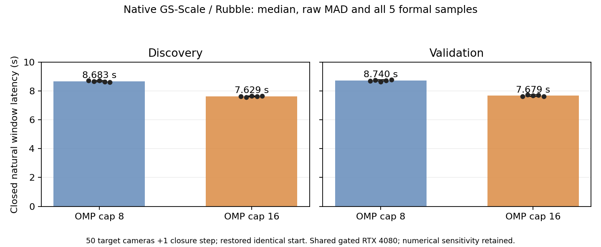

# AI-ARCH Q1｜3DGS晚期原生实验完整完成

日期：2026-11-09（Asia/Shanghai）。

**NATIVE_Q1_LATE_PIPELINE_COMPLETE。** 已完成完整状态自然推进与实际恢复、T8/T16两阶段原生对照、observer OFF/ON分池、目标更新credit闭合、末态保存与重载及保留camera验证。没有晋升新GPU硬件机制：NO_HARDWARE_CANDIDATE_PROMOTED。

本轮是用户新授权的科学接续，基线491b8e5177c954ac7df609724fd8a6fad483af61，原科学合同34a598f4e5f40fffde337ae6b167bd4ffb3fccac。所有旧V1/R1/R2 authority和raw保持只读。本轮W1曾发生已记录的完成退出监控STOP；在同一个Goal内修复、完全清理、重新冻结并重新取得合法W2窗口后完成，不回写旧STOP。

## 主要结果

主指标为50个目标camera步骤加1个原生closure步骤的完整Host monotonic窗口；恢复、初始化、checkpoint与最终进程退出不计入正式时延，但计入资源账。每格5次正式样本，另2次预热，交错顺序；全部20个正式样本保留，无无效/筛除正式样本。

| 自然窗口 | OMP cap8 median / MAD（秒） | OMP cap16 median / MAD（秒） | T16相对T8时延降低 |
|---|---:|---:|---:|
| 发现15150–15199 + closure15200 | 8.683307 / 0.050807 | 7.629178 / 0.026169 | 12.1397% |
| 验证15250–15299 + closure15300 | 8.739618 / 0.037407 | 7.679067 / 0.055039 | 12.1350% |

T16是原接受的基线策略；这些数字是相对T8的受控差异，不是相对原基线获得了新加速。约1.138倍的窗口吞吐/时延比在独立自然camera窗口重复出现。不是完整200000步训练的加速比。

同一phase的每个重复都从严格相同的完整状态恢复，camera顺序SHA完全一致；两phase共各51个实际camera ID，集合不相交。全部窗口N_total=6,720,398。发现T16的N_visible平均约776,947、N_updated约923,349，U/N约13.7395%；验证对应约770,680、912,579及13.5792%。T8对应工作量几乎相同，全部实际差异保留，不据此临时设数值等价阈值。

CPU亲和固定8–21（14logical、10个拓扑core ID），监督22–23；非独占。T8/T16表示OMP_THREAD_LIMIT，实际Torch intra线程请求仍为64，不能说使用了8/16个独立物理核。真实OMP team瞬时组成未逐次计数。

## 成本反证与科学判断

observer ON与正式OFF不混池。发现T16的ON闭合窗口7.880494秒：
- 主线程CPU Adam函数区间3.415587秒；
- CPU参数转发/所需Adam函数区间2.541018秒；
- 二者约占ON窗口75.5867%，验证T16约74.6992%；
- 全局ID选择/扫描0.198928秒，约2.5243%；
- 显式join/synchronize并集仅0.013037秒，约0.1654%；验证约0.1040%。

因此本次晚期窗口的主导主线程成本集中在CPU状态更新与参数生产/转发。将低U/N直接解释为“全局扫描是主要瓶颈”不受本数据支持；仅消除ID选择区间也只对应很小的局部成本上界。把本次闭合窗口的主要成本称为显式GPU等待同样不成立。

GPU事件跨度的中位数为发现T16约27.10ms、验证约25.61ms；事件跨度包含launch gap，不是纯kernel活动时间。没有把GPU事件与Host时间未经校准相减，也没有把CPU与GPU重叠时间相加。

发现ON记录H2D操作数约8.4505GB、D2H约9.3432GB（十进制，51步）。这些是实际Tensor调用的匹配形状/类型操作数，不是DMA、PCIe或DRAM计数；不能除以某个Host调用时间后宣称测到了链路带宽。

结论分级：
- OBSERVED：实际状态、camera、完整窗口时延、线程响应、Host区间与调用payload。
- PARTIALLY_ATTRIBUTED：CPU Adam及参数转发是已测主线程路径主体，线程供给影响完整窗口。
- MODEL_CONSISTENT：GPU与CPU已有流水重叠；显式join等待很小。
- INCONCLUSIVE：CPU自身访存/计算供给的进一步拆分、真实PCIe服务时间、纯GPU活动和DRAM/SM限制。
- 不将任何结果升级为GPU硬件资源CAUSALLY_SUPPORTED或芯片PPA收益。

## 完整状态、更新credit与数值边界

自然推进保留原max_steps=200000、refine_stop=15000、CPUAdam、SH、densification、camera及deferred数学。生产实际到next15240，形成C_D(next15140)、C_V(next15240)。末态另从固定原基线T16与C_V出发，按验证窗口+closure保存C_FINAL(next15301)，并真实GPU重载通过。

三态都含参数/grad、optimizer moments/counters、pending梯度、RNG、loader/camera cursor、live buffers、stable ID与alias。独立CPU复核全部metadata/chunk SHA及每态35个完整浮点字段均有限，无未覆盖浮点view；每态44个Tensor字段。CPU检查不替代真实GPU恢复。

C_FINAL的GPU已处理15300、CPU已apply到15299、pending为15300、prepared camera15301。目标15250–15299的更新credit已闭合；下一自然camera产生的pending仍完整保存，不称全管线数学队列为空，也没有为清空队列额外修改算法。

20个正式样本初始Runner semantic状态全部精确，参数/moment有限性全部通过。最终状态指纹/部分数值样本存在敏感性；没有新容差、没有训练质量等价PASS。形式上的相同起点与相同camera工作，不被升级为所有浮点轨迹逐bit相同。详见NUMERICAL_OBSERVATIONS.json。没有第二scene或跨scene结论。

## 工程与资源

本轮先修复短命自身线程亲和采样：只有kernel枚举的自身成员、ESRCH、两次自身task路径不存在、父/root/worker同身份健康且无独立gap时，记录affinity=None的显式censored。活线程不可读、身份冲突、未知GPU仍STOP；不伪造完整亲和采样。100次真实Linux线程退出压力回归通过，实际GPU监控也记录了这种censored观察。

W1完成生产及部分预热后遇到worker退出阶段观测STOP。W2增加计算结束且CUDA同步后的完成握手：真实完成文件/hash和身份核验、完整live资源检查、ACK、实际OS退出码、同锁context清理及后续完整采样。受控退出区间的treeRSS不连续采样，kernel charged peak保留；不冒称完整Goal RSS峰值。算法和正式计时边界不变。

两窗口均使用原Image-Lab共同flock、预约和实时门控，一个GPU owner；每次非阻塞获取，无冲突等待。W1持锁2182.335秒，W2持锁2354.855秒，合计4537.190秒，约75分37秒。峰值自身NVML3778MiB、sampled RSS23.367GiB；每窗口charged peak分别27.255GiB和16.915GiB，不把它们简单求和当全Goal上界。两个窗口都在释放前确认自身context清除，预约/锁释放，并有后查收据。

这些容量实测均未触及旧数值上限。完成依靠生命周期处理、完成握手与获准的顺序恢复，而不是证明原机器容量不足。用户解除预算后，节点物理保护仍保留。共享resident、桌面逐进程activity遥测缺口、非独占CPU条件全部注明，不以低MAD证明绝对无干扰。

## 交付与停止

原始正式样本、全部实际job及状态SHA、三份完整私有state、分池诊断、成本台账、数值与资源范围均保留。大state不放Git，通过PRIVATE_RAW_INDEX.json和固定SHA引用；只轮换本轮已被更晚完整状态取代的临时恢复点，不删除旧资产。

本轮没有执行CLM/TideGS替代实现或穷尽所有软件优化。强软件碰撞与语义边界见SOFTWARE_EXCLUSION.md。当前没有足够证据支持新的GPU微架构候选；本3DGS结果可作为真实late pipeline分析基点。

完成Git发布、远端commit/tree/blob核验和worktree clean后STOP，不自动启动新Goal、第二scene、Profiler、硬件机制、模拟器或RTL。
