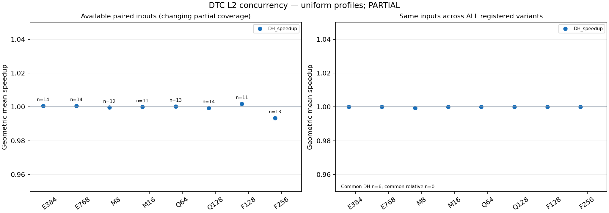

# 参数收益：当前部分覆盖

来源：dashboard/report.json，SHA `e909f94c2c45ee348d158a7dcdf1296ef3de08bf38af29349ecd30494cc373da`。各行人口不同，不能按GM直接排行；比值为同输入DH_P0/DH_variant。

| Profile | Paired /35 | GM | Median | Positive / Equal / Negative |
|---|---:|---:|---:|---:|
|E384|14/35|1.000616015|1.000000000|1/12/1|
|E768|14/35|1.000616015|1.000000000|1/12/1|
|M8|12/35|0.999649742|1.000000000|0/10/2|
|M16|11/35|1.000000000|1.000000000|0/11/0|
|Q64|13/35|1.000289702|1.000000000|1/11/1|
|Q128|14/35|0.999360972|1.000000000|0/12/2|
|F128|11/35|1.001798063|1.000000000|1/10/0|
|F256|13/35|0.993427161|1.000000000|0/11/2|

全部8个profile共同输入仅6/35：BlackScholes, gaussian, heartwall, histogram, lud, transpose。占全35预计指令量0.47644%。指令量不是运行时间充分预测。
P0同版本CH/DH部分配对17/35，GM=0.996112634，median=1.015067251，DTC正/等/负=12/0/5。不是全套结论。

## 所有已观察非中性参数配对

| Program | Profile | DH P0 cycles | Variant cycles | DH speedup | Input SHA prefix |
|---|---|---:|---:|---:|---|
|vectorAdd|F256|217305|236217|0.919938023|e7bb67e63e3c3847|
|vectorAdd|Q128|217305|219002|0.992251212|e7bb67e63e3c3847|
|heartwall|M8|8551|8587|0.995807616|731af5428c4b8155|
|fastWalshTransform|F256|185317|185740|0.997722623|f7f22a2ccc836a8a|
|fastWalshTransform|Q128|185317|185534|0.998830403|f7f22a2ccc836a8a|
|fastWalshTransform|Q64|185317|185420|0.999444504|f7f22a2ccc836a8a|
|fastWalshTransform|E384|185317|185345|0.999848930|f7f22a2ccc836a8a|
|fastWalshTransform|E768|185317|185345|0.999848930|f7f22a2ccc836a8a|
|bfs|M8|4170294|4170305|0.999997362|1df9d5479504d9c7|
|vectorAdd|Q64|217305|216368|1.004330585|e7bb67e63e3c3847|
|vectorAdd|E384|217305|215407|1.008811227|e7bb67e63e3c3847|
|vectorAdd|E768|217305|215407|1.008811227|e7bb67e63e3c3847|
|vectorAdd|F128|217305|213053|1.019957475|e7bb67e63e3c3847|

所有负收益保留；不逐程序选择最优配置。非P0 CH配对尚未具备，DTC相对收益改善不可据此确认。

