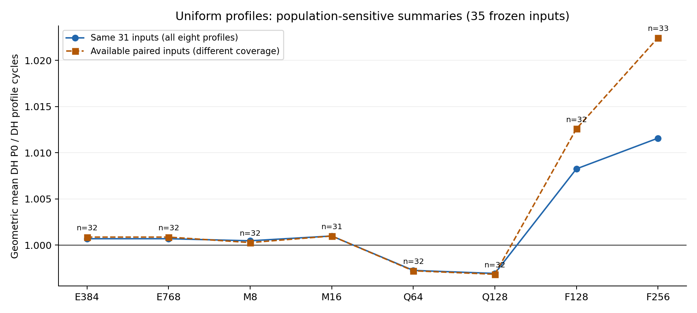

# 已登记实验收尾：当前数据与历史长尾

快照：2026-10-29T02:15:58.450936+00:00。用户确认本轮只收尾已登记实验；CH-F256 35点与组合搜索列为下一阶段。英文 v0.23 未改，七项未决输入未晋升。

本轮原始350格严格接受 **323**（317个新测量、6个合法P0复用）。独立named视图的已验证来源覆盖为324/350，其中scan/M16的R2单列引用；没有把R2、IR或失败改成原始accepted。当前实际存活12路，尚未启动12点；后台最终部署状态以随后交接记录为准，本快照不宣称科学全覆盖。

- [完整当前分析与三张图](current_l2/README.md)
- [原始350格表](current_l2/all350_cells.csv)
- [280组DH对照](current_l2/all280_DH_pairs.csv)
- [配对计数器观察](current_l2/all_paired_counter_observations.csv)
- [历史长尾状态与配置证据](historical/REPORT.md)

## 当前L2参数结论

F256相对自身P0：同一31程序GM **1.011580804**；available33为 **1.022440468**，二者分母不同。F128→F256同31配对GM **1.003295032**。E384→E768在32个有效配对上cycles完全相同。M8→M16同31 GM约1.000519，Q64→Q128约0.999670。

这些是DH自身收益。目前没有非P0 CH匹配结果，不能据此宣布DTC相对传统缓存的优势扩大、最终统一胜者或等面积收益。全部回退与缺失保留，详见完整分布和套件统计。

## 历史P0/PQ/PS：各自P0周期为1，越小越好

downstream18已全部严格通过、归档及native恢复验证。

| 程序 | CH-PQ | CH-PS | DH-PQ | DH-PS |
|---|---:|---:|---:|---:|
| ATAX | 1.0812 | 0.7290 | 1.0594 | 0.6076 |
| MVT | 0.8870 | 0.6925 | 1.0226 | 0.6288 |
| BICG | 0.9261 | 0.8546 | 1.0177 | 0.6401 |

PQ仅把partition queue从64:64:64:64改为64:256:64:64。PS仅把DRAM时钟850→1700MHz，因此不混入本轮固定850MHz的L2扫描。MVT DH-PQ已完成，慢约2.26%；DH-PS快约37.12%。结果支持下游服务速率敏感性，不能确定唯一DRAM带宽瓶颈。

旧V100当前没有native simulator存活；其284次启动并不等于旧72/288计划完成。保全的receipt缺口与工程问题详见历史表。另有SYRK S/F及LAVAMD F三条独立EP长尾真实运行，进度不能代替accepted性能，也没有可靠完工ETA；它们与DTC分开报告。

## 两项新失败的闭合

lavamd CH-P0（98d83595…）与hybridsort DH-E768-IR1（eda14f50…）被旧运行保护以host可用内存低于8GiB停止，退出码分别-9、-15；不是自然性能结果。当时cgroup仍有约90GB余量，没有新OOM。现有时间序列不足以精确归因外部PID。

旧consumer错误地要求失败分支先有performance strict，导致归档HOLD。现在已用原UUID完成真164归档和native恢复；RESULT均为FAIL_L2MLP_ARCHIVED_NO_RETRY、cycles=null、performance_accepted=false。原stop/raw/身份不变，未自动重跑。见[failure_resolution](failure_resolution/)与[evidence](evidence/)。

后续后台更新只消费严格自然闭合及合法负例归档，保留未完成/失败/缺证据；不以缺失计数器作零，不新增CH/组合身份，不修改历史账本或原角色。后台部署完成后将追加精确源码、进程、授权和自动发布交接记录。
