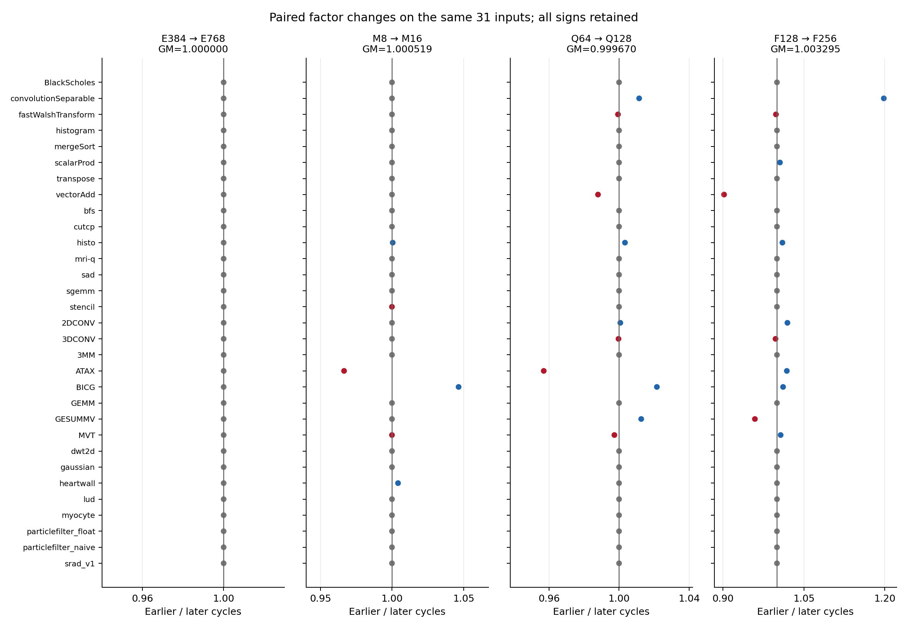
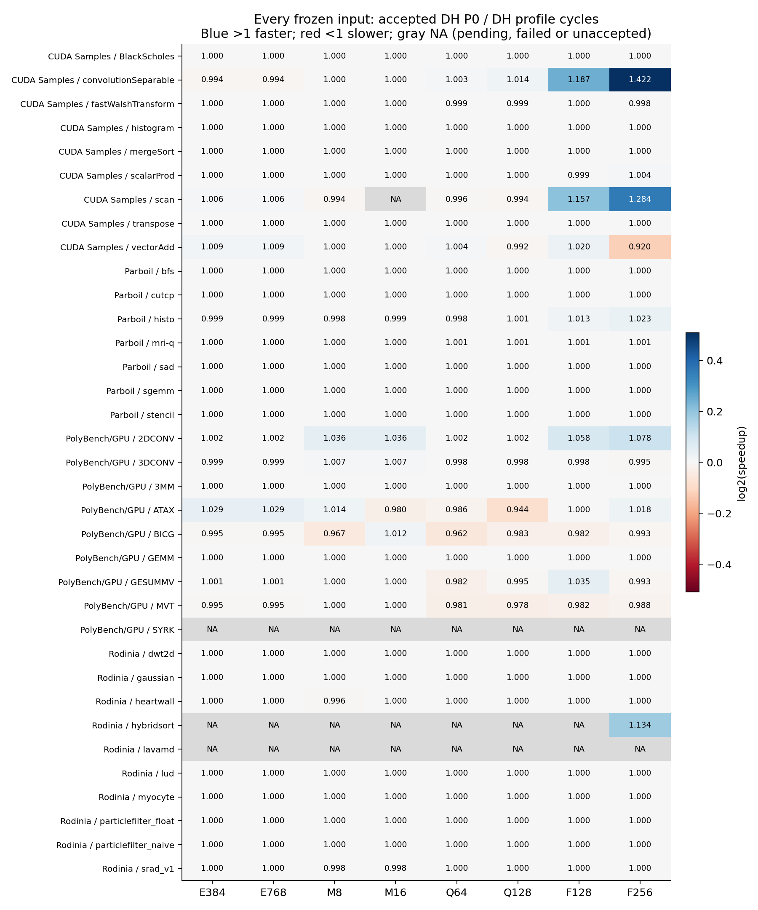

# Current accepted DTC-L2 performance snapshot
**PROVISIONAL_PARTIAL_COVERAGE** — 2026-10-29T01:28:38.766930+00:00. Original matrix **323/350 accepted =317 fresh +6 ratified references**, 35 fixed inputs. All 322 accepted E-v4 RESULT hashes remain identical. No simulation or production change was performed.

DH speedup is same-input accepted DH P0 cycles / DH variant cycles. A value above 1 is faster. Each row uses one uniform profile. The all-profile intersection remains 31 inputs; all other inputs and every failed/missing cell remain visible in the full tables. Exact equality determines neutral; these deterministic runs do not supply sampling confidence intervals.

| Profile | Available n/35 | Available GM | +/=/- | Missing | Same31 GM | Same31 +/=/- |
|---|---:|---:|---:|---:|---:|---:|
| E384 | 32/35 | 1.000874 | 5/21/6 | 3 | 1.000697 | 4/21/6 |
| E768 | 32/35 | 1.000874 | 5/21/6 | 3 | 1.000697 | 4/21/6 |
| M8 | 32/35 | 1.000280 | 5/20/7 | 3 | 1.000474 | 5/20/6 |
| M16 | 31/35 | 1.000994 | 5/21/5 | 4 | 1.000994 | 5/21/5 |
| Q64 | 32/35 | 0.997226 | 4/20/8 | 3 | 0.997271 | 4/20/7 |
| Q128 | 32/35 | 0.996854 | 4/20/8 | 3 | 0.996942 | 4/20/7 |
| F128 | 32/35 | 1.012595 | 7/19/6 | 3 | 1.008259 | 6/19/6 |
| F256 | 33/35 | 1.022440 | 8/19/6 | 2 | 1.011581 | 6/19/6 |

Configuration remains Core9eedb313 / Framework02775fd7 / binary02a28936; DRAM850MHz, L2 capacity10MiB, Hash/DTC/clock fixed. P0 has MSHR entries192, merge4, miss queue32 per L2 subpartition, FRFCFS64 per controller. E384/E768 change entries; M8/M16 change merge; Q64/Q128 change miss queue; F128/F256 change FRFCFS. Structural resource limits do not measure occupancy or area; FRFCFS changes also affect memory-partition credit coupling. Exact options and source-spec hashes are in PRIMARY_SNAPSHOT.json.

The available GM uses different coverage in each profile and is not a final35 ranking. F256 **same31 GM=1.011580804**, while its **available33 GM=1.022440** includes the additional accepted paired inputs. These denominators must remain distinct.

| Factor direction | Paired n/35 | GM | +/=/- | Missing | min / median / max | Same31 GM |
|---|---:|---:|---:|---:|---:|---:|
| E384 → E768 | 32/35 | 1.000000 | 0/32/0 | 3 | 1.000000 / 1.000000 / 1.000000 | 1.000000 |
| M8 → M16 | 31/35 | 1.000519 | 3/25/3 | 4 | 0.966503 / 1.000000 / 1.046540 | 1.000519 |
| Q64 → Q128 | 32/35 | 0.999627 | 5/21/6 | 3 | 0.956985 / 1.000000 / 1.021596 | 0.999670 |
| F128 → F256 | 32/35 | 1.006462 | 8/20/4 | 3 | 0.901938 / 1.000000 / 1.198047 | 1.003295 |

F128→F256 is computed per same input before the GM: **1.003295031571× on same31 (7 positive,20 equal,4 negative)**. It is not a quotient of GMs from different available populations. Distributions, p10/p90, every full input digest, missing populations and suite splits are in `SUMMARY.json`.

Suite GMs use the accepted paired members of each frozen suite, with n shown explicitly:

| Suite | E384 | E768 | M8 | M16 | Q64 | Q128 | F128 | F256 |
|---|---:|---:|---:|---:|---:|---:|---:|---:|
| CUDA Samples | 9/9 · 1.000991 | 9/9 · 1.000991 | 9/9 · 0.999364 | 8/9 · 1.000000 | 9/9 · 1.000271 | 9/9 · 0.999935 | 9/9 · 1.037979 | 9/9 · 1.059559 |
| Parboil | 7/7 · 0.999835 | 7/7 · 0.999835 | 7/7 · 0.999758 | 7/7 · 0.999826 | 7/7 · 0.999840 | 7/7 · 1.000322 | 7/7 · 1.002002 | 7/7 · 1.003439 |
| PolyBench/GPU | 8/9 · 1.002529 | 8/9 · 1.002529 | 8/9 · 1.002864 | 8/9 · 1.004295 | 8/9 · 0.988787 | 8/9 · 0.987269 | 8/9 · 1.006401 | 8/9 · 1.007772 |
| Rodinia | 8/10 · 1.000000 | 8/10 · 1.000000 | 8/10 · 0.999190 | 8/10 · 0.999715 | 8/10 · 1.000000 | 8/10 · 1.000000 | 8/10 · 1.000000 | 9/10 · 1.014066 |

Heatmap numbers are rounded; exact signs and full-precision ratios remain in the tables. Every original cohort, input digest, cycles, acceptance state and RESULT source SHA is in `all350_cells.csv` / `ALL_CELLS.json`; all 280 DH comparisons are in `all280_DH_pairs.csv`. Blank CSV numeric fields mean missing, never zero. Accepted-result counter values and zero-denominator flags are in `all_paired_counter_observations.csv`.

Observed cases (all are associations; no critical-path or causal attribution):

| Input | E384 | E768 | M8 | M16 | Q64 | Q128 | F128 | F256 |
|---|---:|---:|---:|---:|---:|---:|---:|---:|
| ATAX | 1.028813 | 1.028813 | 1.014056 | 0.980088 | 0.986344 | 0.943917 | 0.999548 | 1.017823 |
| MVT | 0.994968 | 0.994968 | 1.000052 | 1.000039 | 0.980552 | 0.977938 | 0.981743 | 0.988434 |
| BICG | 0.994996 | 0.994996 | 0.967226 | 1.012241 | 0.961800 | 0.982571 | 0.982038 | 0.993156 |
| 2DCONV | 1.002246 | 1.002246 | 1.036346 | 1.036346 | 1.001645 | 1.002368 | 1.057515 | 1.078012 |
| 3DCONV | 0.998748 | 0.998748 | 1.006512 | 1.006512 | 0.998146 | 0.997830 | 0.997599 | 0.994891 |
| particlefilter_naive | 1.000000 | 1.000000 | 1.000000 | 1.000000 | 1.000000 | 1.000000 | 1.000000 | 1.000000 |
| 3MM | 1.000000 | 1.000000 | 1.000000 | 1.000000 | 1.000000 | 1.000000 | 1.000000 | 1.000000 |
| GEMM | 1.000000 | 1.000000 | 1.000000 | 1.000000 | 1.000000 | 1.000000 | 1.000000 | 1.000000 |
| vectorAdd | 1.008811 | 1.008811 | 1.000000 | 1.000000 | 1.004331 | 0.992251 | 1.019957 | 0.919938 |
| convolutionSeparable | 0.993961 | 0.993961 | 1.000000 | 1.000000 | 1.002851 | 1.014358 | 1.187151 | 1.422263 |
| scan | 1.006375 | 1.006375 | 0.994288 | NA | 0.995834 | 0.994126 | 1.156693 | 1.283635 |
| hybridsort | NA | NA | NA | NA | NA | NA | NA | 1.133954 |

- ATAX shows an E384/E768 gain and a Q128 regression; MVT is mostly flat/negative; BICG improves under M16 and regresses under M8. These different responses prevent a universal monotonic capacity/MLP conclusion.
- F256 helps 2DCONV, convolutionSeparable and scan, while vectorAdd regresses. convolutionSeparable/scan gains coexist with higher last-printed MRQ averages (321→405 and184→228). vectorAdd has unchanged DRAM read atoms and fewer reservation failures despite taking more cycles.
- 3MM/GEMM/particlefilter_naive are exactly flat across accepted DH scans. 3MM/GEMM recorded DRAM counters are explicitly0; their MRQ values are missing. This is scoped simulator evidence, not proof of zero real-application DRAM traffic. GEMM and Parboil sgemm are distinct identities.
- The only newly accepted original result since E-v4 is hybridsort F256: **16,370,955 cycles**, versus P0 **18,563,916**, speedup **1.133954×**. This does not fill its failed/missing variants or alter the same31 intersection.
- Keep the 35 input identities fixed, retain failures/negative gains, and finish their existing tails before claiming final35 superiority. No non-P0 CH result is accepted: the selected CH-F25635 follow-up remains a review proposal; relative DTC improvement cannot be computed.

Original350 status at acquisition: `{"FAIL_L2MLP_ARCHIVED_NO_RETRY": 11, "PASS_L2MLP_STRICT_ARCHIVE_NATIVE_RESTORE": 317, "PENDING": 12, "REFERENCE_ACCEPTED_NO_NEW_START": 6, "RUNNING_CONFIRMED": 2, "SPENT_LIVENESS_UNVERIFIED_AWAITING_TERMINAL": 1, "TERMINAL_AWAITING_STRICT_ARCHIVE": 1}`. Controller context separately lists 8 active running memberships and remaining=16 across a broader scope including independent IR; original350 has only 2 confirmed live cells. A controller membership is not acceptance. Failed cells retain source SHA and optional raw-reported cycles solely for diagnostics. Pending/FAIL/HOLD/repair data never enter performance arithmetic.

IR, R2, engineering and namedDerived35 are excluded from every formal statistic here; no automatic union or substitution. The original scan M16 remains unaccepted. The independently accepted R2 is documented by frozen E-v4 only, with cycles6,702,538; that result does not replace its original negative. Historical J work is outside this report. English v0.23 is unchanged and the seven UNRESOLVED inputs remain outside the frozen35.

L2 values follow the existing single-stream binding evidence; unsupported whole-trace values remain null. DRAM counters are globally cumulative. Last-printed MRQ is not a weighted application mean; dramfull denotes ICNT-to-memory blockage. Missing MSHR reasons do not mean zero. Counter changes cannot establish causality or numerical full-application correctness.

Reproduce on an environment with Python, numpy and matplotlib: `python3 analyze.py`. `collect.py` was run once using the previously qualified generator SHA9ad9cdf8…; it acquires individually coherent source files (not an atomic controller transaction). `PRIMARY_SNAPSHOT.json` contains their exact paths and SHA256. No fresh native/engineering audit, production/controller/Goal/READY/Git operation, model launch or new scope registration occurred. `MANIFEST.json` hashes every delivered file.
