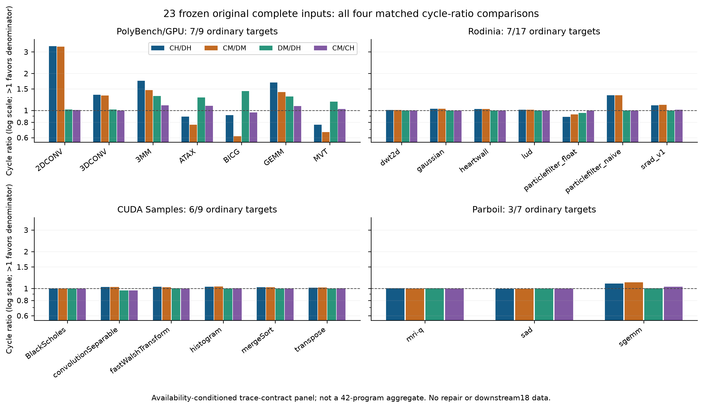

# DTC P42 多智能体性能归因与 DRAM 敏感性审阅 V1

本轮实际启动六个独立子智能体 A–F，受会话容量限制最多三个同时运行；只有 B 执行一次共享地址扫描，其余消费同一产品。所有工作均为只读研究及独立文档/代码。未启动、重跑、重发或控制模拟；原 controller、租约、预算、raw、冻结输入和英文 v0.23 母稿不变。

## 1. 套件统计：收益存在，但明显集中

基准为 Framework `71584878be0c80375f9d25bcd80e171b7bf4478d` 的 `DTC_PAPER42_HASH_REVIEW_20261027_V1`，冻结 SHA `a4157b56b48d8d8df048b9f64e62d54b091e80176d7a05169ef9c64b0c06da9d`。35 个身份冻结，7 个仍 UNRESOLVED；正式共同集合仅为 23 个原始完整四配置输入，占 42 目标的 54.76%。修复验证和新 downstream18 不填补原始性能缺口。

| 原始23项比较 | GM | 中位数 | 正 / 零 / 负 |
|---|---:|---:|---:|
| CH/DH | 1.123867 | 1.027014 | 18 / 0 / 5 |
| CM/DM | 1.076346 | 1.026611 | 18 / 0 / 5 |
| DM/DH | 1.056689 | 1.000725 | 13 / 6 / 4 |
| CM/CH | 1.012009 | 1.000000 | 9 / 11 / 3 |

同一集合上 Hash 后的相对改善为 1.044150；这不意味着每个程序更快。各套件 CH/DH GM：PolyBench/GPU 1.353126（7/9）、Rodinia 1.049451（7/17）、CUDA Samples 1.023391（6/9）、Parboil 1.031250（3/7）。总体按程序等权，不按套件等权。

2DCONV 占净 log-GM 收益 44.982%，留一诊断 GM 为 1.069475。2DCONV、3DCONV、3MM、GEMM、particlefilter_naive 五项贡献净 log 收益 106.819%（负例抵消了部分正收益）；其余 18 项诊断 GM 为 0.989876，中位数 1.014947。此诊断不改变正式 23 项集合。MVT、particlefilter_float、ATAX、BICG、sad 五个负例全部保留。

证据：[A总报告](agents/A/SUITE_PERFORMANCE_ANALYSIS.md)、[92 cell完整身份/四配置/回执](agents/A/SUITE_PERFORMANCE_ANALYSIS.json)、[独立复算](coordinator/BASELINE_INDEPENDENT_RECOMPUTATION.json)。58 个 cell 的历史 spec 构建声明与实际 launch 不同，A 分别保存旧声明和真实 strict/launch 身份，未把旧声明当成执行二进制。

## 2. 应用特征：独立定义、随后观察性能

分类合同在联结 DH 结果前冻结；标签允许重叠，不能相加成为不相交总体，也不能把流量类别称为关键路径证明。

| 独立特征组 | 项数 | 观察到的 CH/DH GM | 边界 |
|---|---:|---:|---|
| CH L2 ready-hit ≥80% | 17 | 1.099928 | 请求服务位置，不是耗时占比 |
| 跨线程行数放大候选 | 3 | 0.855661 | ATAX/MVT/BICG，不等于已证 set conflict |
| 低CTA并行度 | 4 | 0.895613 | CTA/SM上界，不是实测 occupancy |
| MUFU trace 密集 | 3 | 1.011680 | 指令记录密度，不是执行时间占比 |

唯一共享 producer 扫描 405,199,005 B，耗时 173.63 秒，RSS 峰值 75,444 KiB；单进程 nice19，1 GiB AS、1 GiB IO、15分钟及8 MiB/s限额。ATAX/MVT K1 和 BICG K2 完整扫描并复核全 SHA；2DCONV/3MM/GEMM 各仅16 MiB前缀。原 warp 回执计数127保留，另附派生元数据128修正说明，无重扫、无改历史资格。

三项跨步 kernel 相邻矩阵 lane 地址跨度16384 B，每个仅16 CTA/128 warp，静态复访约33次/唯一128B行。复访多但性能为负，证明复访本身不足以预测 DTC 优势。静态 trace 顺序不是真实跨 SM 时间顺序，重复地址不是同线在途 DRAM 重复请求。

证据：[分类合同](agents/B/CLASSIFICATION_CONTRACT.md)、[逐程序/逐kernel矩阵](agents/B/WORKLOAD_FEATURE_MATRIX.json)、[B报告](agents/B/FEATURE_ANALYSIS_REPORT.md)、[共享索引](shared_address_index/INDEX.json)。32B sector/atom、128B line、warp记录和active-thread指令各自保留单位。未扫描的17项不是“低复用”样本。

## 3. 高收益归因：2DCONV优先，保留服务时序风险

2DCONV 的 CH/DH 为3.347255，CM/DM已有3.314588；传统Hash仅1.006686、DTC Hash仅1.016608。CH→DH L2读量只减少0.767%，DRAM读量完全相同。因此主收益不能解释为 Hash 或 DRAM 流量减少。

传统路径存在315,294,062个 merge-full 拒绝事件；MSHR512是地址项容量，同地址merge上限仍为8。DTC pending引用合并与大量OO退休伴随收益，但尚未隔离各自因果份额。DH约188.6万次Tag淘汰中仅12次 deferred reclaim，不支持将此案例的主要收益解释为频繁保留失Tag的在用数据。

particlefilter_naive 的 Hash 收益、传统 merge-full、DTC Tag淘汰均为零，仍有1.329003倍收益。它是检验命中/完成服务贡献的重要反例，不能继续只用 merge 冲突解释所有正例。

**已确认路径不等价，未证明模型吞吐错误。** CH 使用4bank、20stage的可流水化L1延迟队列；20不是串行吞吐1/20。DH OO cacheable load不经过同一20stage，但确实承担Tag+1、返还metadata+1、4waiter通知/SM/core-cycle、4sector gather/cycle、1instruction retire/cycle及共享WB仲裁。两者容量、Tag、PIB/MSHR粒度和电路时序也未等价匹配。故当前可以报告完整模型收益，不能将收益份额单独归为Tag/Data解耦，亦不能声称等面积优势。

3MM/GEMM的同设计DM→DH控制有更直接的Hash敏感性证据：Tag替换减少78.697%/80.749%，下行创建请求减少78.265%/79.484%，cycles减少23.878%/22.897%。四配置DRAM读量均为零，改善在片上路径；不能写成DRAM读取减少。

证据：[C报告](agents/C/POSITIVE_CASE_MECHANISM_REPORT.md)、[20 cell身份和计数位置](agents/C/POSITIVE_CASE_MECHANISM_REPORT.json)、[原Core逐行源码语义](agents/C/SOURCE_SEMANTICS.json)。缺失计数器保持null，拒绝事件不当作独占stall周期。

## 4. 三项负例：流量关系已解释，唯一根因尚未隔离

| 原始输入 | L2接受读量 DH变化 | accepted miss比例 CH→DH | DRAM读量 DH变化 | 慢kernel DH周期变化 |
|---|---:|---:|---:|---:|
| ATAX | −25.40% | 25.38%→39.44% | +15.95% | K1 +13.30% |
| MVT | −25.72% | 23.91%→42.41% | +31.74% | K1 +33.04% |
| BICG | −30.63% | 24.02%→39.48% | +14.02% | K2 +10.11% |

六个原始cell、十二个kernel均核对 `accepted GLOBAL_ACC_R MISS+SECTOR_MISS = DRAM issued read atoms`。两设计下行128B请求都在L2分成4个32B sector；没有把reservation-fail重试或MSHR_HIT补充状态重复加到分母。

因此 `DRAM_DH/DRAM_CH = L2accepted_DH/L2accepted_CH × miss_fraction_DH/miss_fraction_CH`。下降的接受量被更高的miss比例抵消。三个慢kernel占CH周期93%以上，另一个合并访问kernel在DH均更快。低CTA是共享限制，不能独立解释两设计差异。

L2时间局部性/替换、请求顺序、跨SM节奏和同线后续重取是候选连接路径。现有静态地址重复、占用均值和最终occupancy=0均不能证明在途重复请求，也不能排除PIB或物理池曾经阻塞。已输出的OO lower-create-full为0、ready→complete约4.2cycles、少量WB阻塞削弱了这些已观测后段点为唯一瓶颈的解释；未打印的PIB-full、NO_FREE_LINE、OO Tag conflict仍未知。

`gpu_stall_dramfull` 实为ICNT→L2入口受阻事件，既不是PQ的FIFO-full，也不是DRAM服务时间。`avg_mrq_latency`只覆盖dram_req创建到FRFCFS分配bank，不含前面的L2 FIFO及后面的完整服务/返回。

证据：[D报告与分级假设](agents/D/STRIDED_WORKLOAD_ROOT_CAUSE_REPORT.md)、[六cell/十二kernel及原raw位置](agents/D/STRIDED_WORKLOAD_ROOT_CAUSE_REPORT.json)。静态地址由B唯一产品提供，D未重扫。

## 5. PQ/PS独立审查：完整结果替代早段外推

E固定截止 `2026-10-27T07:32:45Z`，10/18严格accepted，8pending。以下仅使用同一新合同的自然DONE、strict、164归档和独立原生恢复核验结果。

| 输入 | CH P0/PQ | CH P0/PS |
|---|---:|---:|
| ATAX | 0.924878（退化） | 1.371738 |
| MVT | 1.127420 | 1.444049 |
| BICG | 1.079744 | 1.170177 |

PQ仅第二FIFO64→256。已观察区间FIFO-full消失，但ATAX整输入cycles仍增加8.122%、DRAM读取增加9.524%；MVT反而更快且avg_mrq455→478。一个平均等待或full事件不能单独代表关键路径。

PS仅DRAM域850→1700MHz，其余核心/ICNT/L2时钟和DRAM周期计数参数不变。它同时加快服务机会并缩短DRAM计数时序对应的绝对ns延迟，不能称纯带宽翻倍。固定dram_latency=100仍是core周期，约70.922ns。CH完整输入只改善1.17–1.44倍，同时DRAM读量增加31.6–66.0%；前5%约2倍不可外推。

BICG PS已有合法CH/DH=1.223868；但缺DH P0，全部 `K_X=(DH_P0/DH_X)/(CH_P0/CH_X)` 仍PENDING。不能借旧Core的P0补齐。BICG CH完整K1 P0/PQ精确相同，审阅标为EXACT_EQUAL，纠正早期看板的笼统标签。未完成输入内已结束kernel不晋升为accepted结果。

**有限追加截止 `2026-10-27T07:54:13Z`（北京时间15:54）：11/18 accepted、7pending。** 新增ATAX DHPS自然完成，19,369,013 cycles，PS下CH/DH=1.069992。K仍全部pending。旧10点V1审查文件逐字节保留，新增结果单独进入 [E追加审查](agents/E/LATEST_ACCEPTED_ADDENDUM.md) 与 [追加SHA/回执](agents/E/LATEST_ACCEPTED_ADDENDUM.json)，不改D引用的旧截止快照。

这18点属于Core `9eedb3131937748f0492fa83aad37d3691118d70` / FW `02775fd795cde5aae1480d81cee6eb481d0a08f4`，与原23项Core `2e3bef4364e578cddd0e881c0baace2e51c55930` 的身份分开。即使某些CH P0 cycles数值恰相同，也不赋予DH跨源可替代性。

证据：[E独立审查](agents/E/PQ_PS_INDEPENDENT_REVIEW.md)、[accepted完整SHA链](agents/E/ACCEPTED_CELL_EVIDENCE.json)、[配置资格](agents/E/CONFIGURATION_QUALIFICATION.json)、[pending清单](agents/E/PENDING_CONSUMPTION.json)。本报告不预测最终cycles；后续自然完成不改变这一固定审查截止。

## 6. 七项输入身份与42程序边界

35项V1冻结与ATAX前缀排除证明不变；七项仍不得强行晋升。F按源码、原始命令、输入数据及捕获范围提出V2条件建议，绝不按PASS、加速比或运行时长选输入。

backprop、nn、nw、pathfinder可以提出标准发布命令优先的V2候选，但候选不等于已完成输入内容/捕获二进制认证。kmeans仍缺真实dataset内容和收敛日志。CFD五kernel不包含标准time_step迭代；streamcluster五次compute_cost与标准pFL调用规模也存在范围矛盾，须先补ROI、capture时二进制或提前退出证据。不能把完整声明trace的验收重新解释为完整应用认证。

证据：[F逐项裁决](agents/F/SEVEN_UNRESOLVED_ADJUDICATION_REPORT.md)、[候选和缺证位置](agents/F/SEVEN_UNRESOLVED_ADJUDICATION_REPORT.json)。这些是V2建议，不改V1、不自动换输入。

## 7. 哪些可以进入论文，哪些仍缺因果证据

| 结论 | 当前可用范围 |
|---|---|
| 固定原始23项四配置分布、GM、贡献和负例 | 可作该trace-contract/model集合的统计证据；必须披露23/42与捕获/数值认证边界 |
| 3MM/GEMM同设计Hash改变及Tag/片上下行变化 | 可报告控制条件下的敏感性与计数关联；不能扩成DRAM收益或跨设计纯解耦因果 |
| 2DCONV/3DCONV/PF naive Hash不是主要收益来源 | 可用四配置直接支持；主要完整DTC设计收益须披露服务/容量差异 |
| ATAX/MVT/BICG慢段定位与接受量×miss比例恒等式 | 可报告事实；具体L2替换、重复请求和物理池因果仍未证 |
| PQ/PS已关闭配对 | 可报告独立新合同的当前accepted结果；K仍pending，PS非纯带宽 |
| 等面积、等时序、仅Tag/Data或仅OO的硬件因果份额 | 当前不足；需匹配服务/资源消融或请求事件证据 |
| 42个完整已验证应用、静态复访即memory-bound、普遍加速 | 当前不成立 |

英文v0.23仅作为最后用户确认母稿，本轮未自动改稿。

## 8. 后续优先级与复现

先只读消费现有18点的后续合法完成，补全CH/DH相对恢复；不为填表重启或增加点。最多五个新的候选实验及资源范围见 [最小实验合同](FOLLOWUP_CONTRACTS.json)，全部为 `NEW_SCIENTIFIC_EXECUTION_APPROVAL_REQUIRED`。

1. 2DCONV/PF naive匹配命中与完成服务，先解决最影响论文解释的模型风险。
2. 一个跨步输入的有界请求/队列/PIB/physical事件观测，区分L2替换、顺序重取、在途重复和独立阻塞。
3. 保持主要DRAM绝对ns时序的频率对照，拆开当前PS混合效应。
4. 2DCONV conventional merge上限敏感性，单变量检验深合并关联。
5. 仅在现有三角完成且显示交互疑点后，补PQ×PS联合角。

完整来源入口为 [证据索引](EVIDENCE_INDEX.json)、[主交叉审查](coordinator/CROSS_REVIEW.json) 和各Agent交付清单。大型中间元数据、原始计数提取和固定周期快照仅在164归档，Git保留派生报告、定义、代码、关键身份/计数表及图；归档与Git各自文件清单及SHA均记录。原raw/trace/二进制不进入Git。

复现统计使用A的 `analyze_suite.py --input-dir <原始715审阅输入目录> --output-dir <独立目录>`；B的特征重建只读保留metadata，不重跑共享地址扫描；C/D/E/F各代码与输入SHA见其manifest。主 `coordinator/cross_review.py` 验证同一输入、原始92cell、独立新合同及缺失K不填补。发布完整包由主Agent单独提交，子Agent不写Git工作树。
