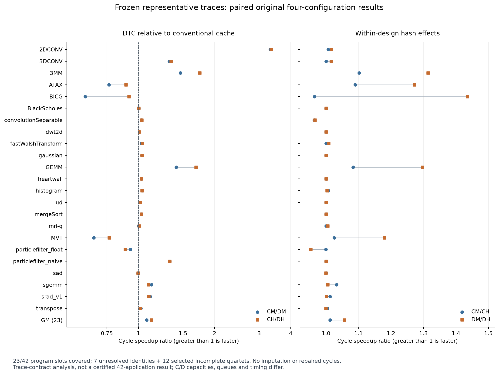
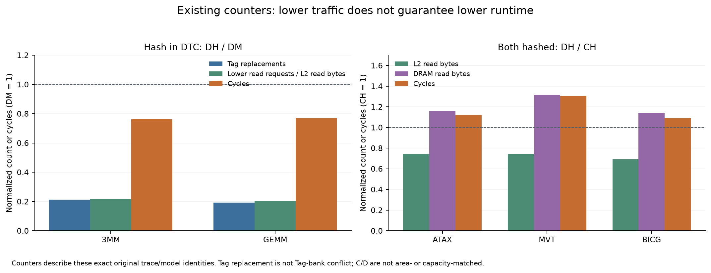

# DTC-MAIN：42 程序候选主集与 Hash 分析（只读）

42 个普通程序槽位中，35 个代表 trace 身份已冻结，7 个 UNRESOLVED；b+tree、hotspot 独立保留。23 个代表项具备完整原始 accepted 四配置结果（23/42=54.76%），另12个已选代表项结果不齐。35项共140个配置格，111格原始accepted。

身份冻结选择的是有内容SHA的历史trace；本轮没有为所有成员补发精确capture-time二进制、原始输入数据与全应用捕获证明。下列GM是已冻结身份、原始有效trace合同下的23项共同集合，不是完整42应用论文GM，也不是新数值正确性认证。

快照：2026-10-27T10:47:12.239455+08:00；身份冻结：2026-10-27T11:03:39.584356+08:00；性能汇总：2026-10-27T11:08:54.795579+08:00。先冻结身份，再生成性能汇总。

冻结 SHA-256：`a4157b56b48d8d8df048b9f64e62d54b091e80176d7a05169ef9c64b0c06da9d`。完整[44→42裁决与72→42映射](REPRESENTATIVE_FREEZE.json)、[四配置结果及72输入原始状态](PERFORMANCE.json)、[12项裁决](TWELVE_ADJUDICATIONS.json)、[瓶颈证据](BOTTLENECK_ANALYSIS.json)、[来源记录](SOURCE_INDEX.json)。

## 主要结论

在同一个23项共同集合，Hash前DTC/传统GM为1.076346×，Hash后为1.123867×；相对改善GM1.044150×。传统Hash本身GM1.012009×，DTC Hash本身GM1.056689×。该集合中，Hash后DTC整体已超过传统缓存；这一结论的范围是23项，不可外推为42项全部超过。相对改善中位数为1.0000×，11项改善、6项不变、6项变差，收益集中于少数矩阵程序。

建议后续优先固定CH作为baseline、DH作为DTC主方案，并保留CM/DM作消融；这符合用户已认可的条件方向。本轮不修改配置、不注册新合同、不启动实验。42整体与论文正式采用仍受未解决身份、缺失结果及来源范围限制。

## 1. 包、台账与身份核对

174-new直接读取164归档`/root/share/mnt164/huangrulin/host174_storage_recovery/dtc_paper_suite_dedup_20261027_v1/review_v1.zip`，ZIP SHA `fa2cab7f27badc1fea5841fb2d65fd7a0eb11055a336925bb9362df32123a304`；CRC及全部5个manifest成员SHA通过。上一版1020个来源中1019个静态文件保持原SHA；唯一变化是自然运行的authority registry。本轮原始矩阵仍251accepted、28真实negative、2未完成、3历史receipt缺口、4Cutcp未准入，共288格。

45个独立修复尝试逐项保留request/cohort/UUID及canonical状态；7份RECOVER12已完成、5份未完成是本次台账快照状态。修复结果永不填入原始cycles。10个旧组件sentinel的canonical工程状态亦保留，不将它们当成完整workload主性能。

两个实际原始Framework版本分别为`cfd3ff56d7ba6642dab6c7710ec4f6065168174e`/binary`ab6c717d…`和`3b362ab5c0934fdcea9697b10244c6de5c4a14ae`/binary`b963139b…`。源码差异只有progress记录上限8192→1048576，既有10项CPU协议资格在本轮重新读证；Core、配置、输入及模型语义不变。251个strict身份与119个结构内Hash配对核对通过。主集合保留跨此观察版本的负例particlefilter_float，未因binary不同将其剔除；严格同binary的22项敏感性结果另列JSON。

## 2. 代表输入与12项裁决

批准规则保持：已有独立默认/参考配置优先；否则只在可比单一问题规模上取中位（偶数取上中位）；不跨未裁决版本或多维算法参数做规模排序。不同SHA的同参数capture不自动视为语义重复；历史72项全部保留。

| 程序 | 选定参数 | 输入SHA前缀 / 状态 | 依据 |
| --- | --- | --- | --- |
| backprop | — | UNRESOLVED | Two different source versions (2.0-ft4096 and3.1 65536) each have a standard command. No approved reference precedence or demonstrated source/data equivalence establishes one version for the42-set. Two4096 captures also differ; do not merge or pick by their outcomes. |
| dwt2d | __data_192_bmp__d_192x192__f__5__l_3 | e5638b94095098ac | PRIOR_REFERENCE_SELECTED: Historical E1 source/input inventory nominates Rodinia3.1 192.bmp -d192x192 -f -5 -l3 (input reference595e63cc...). Trace copies110592=192*192*3 bytes, component split plus3channels*3levels=10 kernels. 1024 variant has unconfirmed source version and different kernel specializations; not treated as duplicate. |
| fastWalshTransform | _logK_11__logD_19 | f7f22a2ccc836a8a | PRIOR_REFERENCE_SELECTED: Previously approved pre-current-performance Extended-20 primary11/19 at selection commit d43b6eec93f68efa94057f34ffa699463b53e6a6, with7/21 explicitly alternate. No dimension-wise ranking of the two pairs. Trace K8192/D2097152 bytes and three transform groups+modulation match source recipe. |
| gaussian | _s_64 | 16f4c42373e4961e | MEDIAN_SIZE_SOURCE_VERIFIED: E1 explicitly did not promote a primary Gaussian command. All five inputs are3.1 same Fan1/Fan2 ForwardSub algorithm; -f/-s only supply matrix/RHS. Trace copies establish N=4,16,64,208,256 and each has2*(N-1) alternating kernels. Median N64, deterministic source-generated matrix; no pivot/precision/algorithm flag changes. Not asserting matrix contents equivalent across sizes. |
| heartwall | __data_test_avi_1___data_result_1_txt | 731af5428c4b8155 | REFERENCE_CAPTURE_PROVENANCE_SELECTED: Both captures carry2.0-ft standard1-frame command. Choose the official archive/capture with SHA-preserved run.sh and known source-alias lineage over1299a96e, which has no retained capture script. Source loop launches one kernel per processed frame; chosen trace contains one full51-CTA grid. Byte/semantic equivalence to alternate capture is NOT asserted. Original video/executable SHA linkage remains provenance gap. |
| hybridsort | r | 09f94fcc7494a03b | UPPER_MEDIAN_SOURCE_VERIFIED: Source3.1 main.cu r fixes SIZE=1<<22=4194304 FP32 values; file variant contains500000 values. Both execute same cudaSort pipeline four times (TEST4). Trace has four16777216-byte input copies and68 kernels, versus four2000000-byte copies and56 kernels. Same sort algorithm, upper median4194304 selects r. Data distributions/realized random input are not declared equivalent. |
| kmeans | — | UNRESOLVED | 2.0-ft400 versus3.1 28k_4x_features/kdd_cup/819200 mix implementation and feature/input semantics. Dataset dimensions/content and a single intended standard configuration are not jointly bound. No one-dimensional median or arbitrary newest-version choice. |
| lud | _s_256__v | b33381cf25d44359 | PRIOR_REFERENCE_SELECTED: Historical pre-current-performance E1 primary is Rodinia3.1 generated -s256 -v. Prefer this identified reference, not pooled median across2.0-ft/3.1 implementations. Trace262144-byte matrix and16 diagonal+15perimeter+15internal kernels match full256 block16 LU. Retain512 and both2.0-ft64 captures as distinct alternatives. |
| nn | — | UNRESOLVED | 2.0-ft command selects3 neighbors;3.1 uses-r5. Source-version and algorithm-parameter differences matter. No approved42-set version/k precedence; two2.0-ft captures not proven equivalent. |
| nw | — | UNRESOLVED | 2.0-ft128x128 and3.1 2048x2048 both standard configurations, but no approved reference precedence across implementations; two128 captures differ. Do not use result size or pass status to decide. |
| pathfinder | — | UNRESOLVED | 2.0-ft1000/20/5 versus3.1 100000/100/20 changes implementation, rows/columns and pyramid height. No fixed cross-version input policy;1000/20/5 captures unproven equivalent. |
| streamcluster | — | UNRESOLVED | 3.1 parameters3/6/16 and10/20/256 change kmin/kmax and point dimension simultaneously. Sample count alone is not a comparable scalar size. No uniquely approved reference among these tuples. |

scalarProd13920：参数化源码`gpu-app-collection@b059fdae…`中VECTOR_N=13920、ELEMENT_N=1024；trace两次57,016,320B输入拷贝吻合。vectorAdd6000000：同一来源解析N=6,000,000，两次24,000,000B输入拷贝和完整grid吻合。没有使用本机未参数化SDK源码冒充历史源码；上游内容和SHA留在164来源证据中。

CFD193K：实际trace首kernel为1008×192线程，对应193,536个padding后cell，不等于已证明原网格nel。三份CFD均仅包含3个initialize、1个step-factor、1个flux，没有time_step；标准3.1源码有2000轮与RK3。缺精确修改版捕获二进制/ROI合同，因此CFD从暂定推荐转为UNRESOLVED，未偷换为另一个已PASS网格。

ATAX普通NO_ARGS：64MiB矩阵、三个16KiB向量、两次16×256全grid与4096² FP32标准两内核源码一致。`dd8955fe…`两份kernel的执行体分别逐字节等于普通记录block0、1前缀，仅grid16→2被改写；不是另一次较小完整应用。见[字节级证明](ATAX_PREFIX_PROOF.json)。只从本轮主集排除，不回写它原先声明grid下的strict PASS。

| ID | 程序 | 决定 | 选定输入SHA前缀 | 版本 | 参数 | 理由 |
| --- | --- | --- | --- | --- | --- | --- |
| P42-01 | 2DCONV | 身份已选 | d984ea5475a581ad | GPU 1.0 source mapping; capture path 11.0 is toolchain label | NO_ARGS | Only ordinary trace identity for this program in the72-input matrix; no outcome-dependent replacement. Keep its recorded source/command/content identity. Exact capture-time executable/input-content and full-application provenance are not newly certified. |
| P42-02 | 3DCONV | 身份已选 | 79f8ab6241faeed6 | GPU 1.0 source mapping; capture path 11.0 is toolchain label | NO_ARGS | Only ordinary trace identity for this program in the72-input matrix; no outcome-dependent replacement. Keep its recorded source/command/content identity. Exact capture-time executable/input-content and full-application provenance are not newly certified. |
| P42-03 | 3MM | 身份已选 | 977a2f7007cb1f96 | GPU 1.0 source mapping; capture path 11.0 is toolchain label | NO_ARGS | Only ordinary trace identity for this program in the72-input matrix; no outcome-dependent replacement. Keep its recorded source/command/content identity. Exact capture-time executable/input-content and full-application provenance are not newly certified. |
| P42-04 | ATAX | 身份已选 | eededb785179fc04 | GPU 1.0 source mapping; capture path 11.0 is toolchain label | NO_ARGS | FULL_SCOPE_SELECTED_PARTIAL_PROVEN: Source PolyBench/GPU1.0 NX=NY=4096, FP32, two kernels and two16*256 grids match67,108,864-byte A plus three16,384-byte vectors. Full declared grids and both source launches retained. dd8955 is proven body-prefix subset with only grid rewritten16->2; excluded regardless of its performance. |
| DERIVED-01 | b+tree | 派生输入独立保留 | — | — | — | Existing input is INDEPENDENT_DERIVED_MODEL_CONDITIONED_INPUT; NOT_ORIGINAL44_SCIENTIFIC_PROMOTION. Independent mechanism reference only. |
| P42-05 | backprop | UNRESOLVED | — | — | — | Two different source versions (2.0-ft4096 and3.1 65536) each have a standard command. No approved reference precedence or demonstrated source/data equivalence establishes one version for the42-set. Two4096 captures also differ; do not merge or pick by their outcomes. |
| P42-06 | bfs | 身份已选 | 1df9d5479504d9c7 | Parboil; capture path 11.0 is not suite revision proof | _i___data_NY_input_graph_input_dat__o_bfs_NY_out | Only ordinary trace identity for this program in the72-input matrix; no outcome-dependent replacement. Keep its recorded source/command/content identity. Exact capture-time executable/input-content and full-application provenance are not newly certified. |
| P42-07 | BICG | 身份已选 | ae34174fbbdf83b2 | GPU 1.0 source mapping; capture path 11.0 is toolchain label | NO_ARGS | Only ordinary trace identity for this program in the72-input matrix; no outcome-dependent replacement. Keep its recorded source/command/content identity. Exact capture-time executable/input-content and full-application provenance are not newly certified. |
| P42-08 | BlackScholes | 身份已选 | b31a85e4eb8d32ef | cudasdk/9.1 path; exact capture provenance not newly certified | NO_ARGS | Only ordinary trace identity for this program in the72-input matrix; no outcome-dependent replacement. Keep its recorded source/command/content identity. Exact capture-time executable/input-content and full-application provenance are not newly certified. |
| P42-09 | cfd | UNRESOLVED | — | — | — | All three traces contain only three initialize kernels, one step-factor and one flux kernel, with no time_step. Source3.1 euler3d has3initialization+2000*(1step+3flux+3time_step) launches. Exact capture-binary modification/ROI contract absent. Thus no input is verified full-application capture. Candidate193K trace actually has padded193536 cells (grid1008*192), not an exact nel identity; raw mesh SHA/nel missing. Historical E1 reference097K also cannot bypass this scope gap. Retain previous193K nomination only as rejected/unresolved provenance, no silent swap to097K. |
| P42-10 | convolutionSeparable | 身份已选 | 4114a3dc0d06b55b | cudasdk/9.1 path; exact capture provenance not newly certified | __size_3072 | Only ordinary trace identity for this program in the72-input matrix; no outcome-dependent replacement. Keep its recorded source/command/content identity. Exact capture-time executable/input-content and full-application provenance are not newly certified. |
| P42-11 | cutcp | 身份已选 | af7320f9d9dc6629 | Parboil; capture path 11.0 is not suite revision proof | _i___data_small_input_watbox_sl40_pqr__o_lattice_dat | Only ordinary trace identity for this program in the72-input matrix; no outcome-dependent replacement. Keep its recorded source/command/content identity. Exact capture-time executable/input-content and full-application provenance are not newly certified. |
| P42-12 | dwt2d | 身份已选 | e5638b94095098ac | 3.1 | __data_192_bmp__d_192x192__f__5__l_3 | PRIOR_REFERENCE_SELECTED: Historical E1 source/input inventory nominates Rodinia3.1 192.bmp -d192x192 -f -5 -l3 (input reference595e63cc...). Trace copies110592=192*192*3 bytes, component split plus3channels*3levels=10 kernels. 1024 variant has unconfirmed source version and different kernel specializations; not treated as duplicate. |
| P42-13 | fastWalshTransform | 身份已选 | f7f22a2ccc836a8a | cudasdk/9.1 path; exact capture provenance not newly certified | _logK_11__logD_19 | PRIOR_REFERENCE_SELECTED: Previously approved pre-current-performance Extended-20 primary11/19 at selection commit d43b6eec93f68efa94057f34ffa699463b53e6a6, with7/21 explicitly alternate. No dimension-wise ranking of the two pairs. Trace K8192/D2097152 bytes and three transform groups+modulation match source recipe. |
| P42-14 | gaussian | 身份已选 | 16f4c42373e4961e | 3.1 | _s_64 | MEDIAN_SIZE_SOURCE_VERIFIED: E1 explicitly did not promote a primary Gaussian command. All five inputs are3.1 same Fan1/Fan2 ForwardSub algorithm; -f/-s only supply matrix/RHS. Trace copies establish N=4,16,64,208,256 and each has2*(N-1) alternating kernels. Median N64, deterministic source-generated matrix; no pivot/precision/algorithm flag changes. Not asserting matrix contents equivalent across sizes. |
| P42-15 | GEMM | 身份已选 | fc0705ae3721e999 | GPU 1.0 source mapping; capture path 11.0 is toolchain label | NO_ARGS | Only ordinary trace identity for this program in the72-input matrix; no outcome-dependent replacement. Keep its recorded source/command/content identity. Exact capture-time executable/input-content and full-application provenance are not newly certified. |
| P42-16 | GESUMMV | 身份已选 | 769e6d9fd5f9cd53 | GPU 1.0 source mapping; capture path 11.0 is toolchain label | NO_ARGS | Only ordinary trace identity for this program in the72-input matrix; no outcome-dependent replacement. Keep its recorded source/command/content identity. Exact capture-time executable/input-content and full-application provenance are not newly certified. |
| P42-17 | heartwall | 身份已选 | 731af5428c4b8155 | 2.0-ft | __data_test_avi_1___data_result_1_txt | REFERENCE_CAPTURE_PROVENANCE_SELECTED: Both captures carry2.0-ft standard1-frame command. Choose the official archive/capture with SHA-preserved run.sh and known source-alias lineage over1299a96e, which has no retained capture script. Source loop launches one kernel per processed frame; chosen trace contains one full51-CTA grid. Byte/semantic equivalence to alternate capture is NOT asserted. Original video/executable SHA linkage remains provenance gap. |
| P42-18 | histo | 身份已选 | 2c506bf13c81ff5d | Parboil; capture path 11.0 is not suite revision proof | _i___data_default_input_img_bin__o_ref_bmp____20_4 | Only ordinary trace identity for this program in the72-input matrix; no outcome-dependent replacement. Keep its recorded source/command/content identity. Exact capture-time executable/input-content and full-application provenance are not newly certified. |
| P42-19 | histogram | 身份已选 | 3722a5c85d91a948 | cudasdk/9.1 path; exact capture provenance not newly certified | NO_ARGS | Only ordinary trace identity for this program in the72-input matrix; no outcome-dependent replacement. Keep its recorded source/command/content identity. Exact capture-time executable/input-content and full-application provenance are not newly certified. |
| DERIVED-02 | hotspot | 派生输入独立保留 | — | — | — | Existing input is INDEPENDENT_DERIVED_MODEL_CONDITIONED_INPUT; NOT_ORIGINAL44_SCIENTIFIC_PROMOTION. Independent mechanism reference only. |
| P42-20 | hybridsort | 身份已选 | 09f94fcc7494a03b | 3.1 | r | UPPER_MEDIAN_SOURCE_VERIFIED: Source3.1 main.cu r fixes SIZE=1<<22=4194304 FP32 values; file variant contains500000 values. Both execute same cudaSort pipeline four times (TEST4). Trace has four16777216-byte input copies and68 kernels, versus four2000000-byte copies and56 kernels. Same sort algorithm, upper median4194304 selects r. Data distributions/realized random input are not declared equivalent. |
| P42-21 | kmeans | UNRESOLVED | — | — | — | 2.0-ft400 versus3.1 28k_4x_features/kdd_cup/819200 mix implementation and feature/input semantics. Dataset dimensions/content and a single intended standard configuration are not jointly bound. No one-dimensional median or arbitrary newest-version choice. |
| P42-22 | lavamd | 身份已选 | ddb6806316876a85 | 3.1 | _boxes1d_10 | Only ordinary trace identity for this program in the72-input matrix; no outcome-dependent replacement. Keep its recorded source/command/content identity. Exact capture-time executable/input-content and full-application provenance are not newly certified. |
| P42-23 | lud | 身份已选 | b33381cf25d44359 | 3.1 | _s_256__v | PRIOR_REFERENCE_SELECTED: Historical pre-current-performance E1 primary is Rodinia3.1 generated -s256 -v. Prefer this identified reference, not pooled median across2.0-ft/3.1 implementations. Trace262144-byte matrix and16 diagonal+15perimeter+15internal kernels match full256 block16 LU. Retain512 and both2.0-ft64 captures as distinct alternatives. |
| P42-24 | mergeSort | 身份已选 | dd9f695c4f53b083 | cudasdk/9.1 path; exact capture provenance not newly certified | NO_ARGS | Only ordinary trace identity for this program in the72-input matrix; no outcome-dependent replacement. Keep its recorded source/command/content identity. Exact capture-time executable/input-content and full-application provenance are not newly certified. |
| P42-25 | mri-q | 身份已选 | dc7a91531846c113 | Parboil; capture path 11.0 is not suite revision proof | _i___data_small_input_32_32_32_dataset_bin__o_32_32_32_dataset_out | Only ordinary trace identity for this program in the72-input matrix; no outcome-dependent replacement. Keep its recorded source/command/content identity. Exact capture-time executable/input-content and full-application provenance are not newly certified. |
| P42-26 | MVT | 身份已选 | f437190767aaed49 | GPU 1.0 source mapping; capture path 11.0 is toolchain label | 20260825-b07c0ad-full / NO_ARGS | Only ordinary trace identity for this program in the72-input matrix; no outcome-dependent replacement. Keep its recorded source/command/content identity. Exact capture-time executable/input-content and full-application provenance are not newly certified. |
| P42-27 | myocyte | 身份已选 | 977e34578994c3d2 | 3.1 | 100_1_0 | Only ordinary trace identity for this program in the72-input matrix; no outcome-dependent replacement. Keep its recorded source/command/content identity. Exact capture-time executable/input-content and full-application provenance are not newly certified. |
| P42-28 | nn | UNRESOLVED | — | — | — | 2.0-ft command selects3 neighbors;3.1 uses-r5. Source-version and algorithm-parameter differences matter. No approved42-set version/k precedence; two2.0-ft captures not proven equivalent. |
| P42-29 | nw | UNRESOLVED | — | — | — | 2.0-ft128x128 and3.1 2048x2048 both standard configurations, but no approved reference precedence across implementations; two128 captures differ. Do not use result size or pass status to decide. |
| P42-30 | particlefilter_float | 身份已选 | b41cc74c66ca6ed4 | 3.1 | _x_128__y_128__z_10__np_1000 | Only ordinary trace identity for this program in the72-input matrix; no outcome-dependent replacement. Keep its recorded source/command/content identity. Exact capture-time executable/input-content and full-application provenance are not newly certified. |
| P42-31 | particlefilter_naive | 身份已选 | 3f85d1878aba9f04 | 3.1 | _x_128__y_128__z_10__np_1000 | Only ordinary trace identity for this program in the72-input matrix; no outcome-dependent replacement. Keep its recorded source/command/content identity. Exact capture-time executable/input-content and full-application provenance are not newly certified. |
| P42-32 | pathfinder | UNRESOLVED | — | — | — | 2.0-ft1000/20/5 versus3.1 100000/100/20 changes implementation, rows/columns and pyramid height. No fixed cross-version input policy;1000/20/5 captures unproven equivalent. |
| P42-33 | sad | 身份已选 | db89be14146b9163 | Parboil; capture path 11.0 is not suite revision proof | _i___data_default_input_reference_bin___data_default_input_frame_bin__o_out_bin | Only ordinary trace identity for this program in the72-input matrix; no outcome-dependent replacement. Keep its recorded source/command/content identity. Exact capture-time executable/input-content and full-application provenance are not newly certified. |
| P42-34 | scalarProd | 身份已选 | 2b93f70cd0666c51 | cudasdk/9.1 path; exact capture provenance not newly certified | __size_13920 | REFERENCE_AND_SIZE_VERIFIED: Pre-performance Extended-20 primary scalarProd_13920; upstream gpu-app-collection b059fdae parameter parser sets VECTOR_N=13920, ELEMENT_N=1024. Trace HtoD A/B each 57016320 bytes =13920*1024*4. Single scalarProdGPU launch. Same result as upper median. |
| P42-35 | scan | 身份已选 | 6df3a84b612086e8 | cudasdk/9.1 path; exact capture provenance not newly certified | NO_ARGS | Only ordinary trace identity for this program in the72-input matrix; no outcome-dependent replacement. Keep its recorded source/command/content identity. Exact capture-time executable/input-content and full-application provenance are not newly certified. |
| P42-36 | sgemm | 身份已选 | ffc8a89493c8a211 | Parboil; capture path 11.0 is not suite revision proof | _i___data_medium_input_matrix1_txt___data_medium_input_matrix2t_txt___data_medium_input_matrix2t_txt__o_matrix3_txt | Only ordinary trace identity for this program in the72-input matrix; no outcome-dependent replacement. Keep its recorded source/command/content identity. Exact capture-time executable/input-content and full-application provenance are not newly certified. |
| P42-37 | srad_v1 | 身份已选 | 0e62c67daa020853 | 3.1 | 100_0_5_502_458 | Only ordinary trace identity for this program in the72-input matrix; no outcome-dependent replacement. Keep its recorded source/command/content identity. Exact capture-time executable/input-content and full-application provenance are not newly certified. |
| P42-38 | stencil | 身份已选 | c885293ad99e21ee | Parboil; capture path 11.0 is not suite revision proof | _i___data_small_input_128x128x32_bin__o_128x128x32_out____128_128_32_100 | Only ordinary trace identity for this program in the72-input matrix; no outcome-dependent replacement. Keep its recorded source/command/content identity. Exact capture-time executable/input-content and full-application provenance are not newly certified. |
| P42-39 | streamcluster | UNRESOLVED | — | — | — | 3.1 parameters3/6/16 and10/20/256 change kmin/kmax and point dimension simultaneously. Sample count alone is not a comparable scalar size. No uniquely approved reference among these tuples. |
| P42-40 | SYRK | 身份已选 | b51811aca9dc70cf | GPU 1.0 source mapping; capture path 11.0 is toolchain label | 20260825-b07c0ad-full / NO_ARGS | Only ordinary trace identity for this program in the72-input matrix; no outcome-dependent replacement. Keep its recorded source/command/content identity. Exact capture-time executable/input-content and full-application provenance are not newly certified. |
| P42-41 | transpose | 身份已选 | 65151d2c661f88f3 | cudasdk/9.1 path; exact capture provenance not newly certified | dimX512_dimY512 | Only ordinary trace identity for this program in the72-input matrix; no outcome-dependent replacement. Keep its recorded source/command/content identity. Exact capture-time executable/input-content and full-application provenance are not newly certified. |
| P42-42 | vectorAdd | 身份已选 | e7bb67e63e3c3847 | cudasdk/9.1 path; exact capture provenance not newly certified | __size_6000000 | REFERENCE_AND_SIZE_VERIFIED: Pre-performance Extended-20 primary vectorAdd_6000000; upstream b059fdae parses N=6000000. Trace A/B each24000000 bytes, full VecAdd grid23438*256 with tail predication. Same result as upper median. |

“身份已选”不表示全应用来源证明已全部闭合；每项scope与缺口在冻结JSON明确记录。这里44个程序名称，与历史Original44（44条实验行、12个workload）不是同一计数。

## 3. 同集合性能与覆盖

| 指标（大于1更快） | GM | 正/零/负 | 中位数 | 范围 | 42目标中缺失 |
| --- | --- | --- | --- | --- | --- |
| 传统 Hash CM/CH | 1.0120× | 9 / 11 / 3 | 1.0000× | 0.9636× ～ 1.1016× | 19 |
| DTC Hash DM/DH | 1.0567× | 13 / 6 / 4 | 1.0007× | 0.9524× ～ 1.4348× | 19 |
| Hash前 DTC/传统 CM/DM | 1.0763× | 18 / 0 / 5 | 1.0266× | 0.6160× ～ 3.3146× | 19 |
| Hash后 DTC/传统 CH/DH | 1.1239× | 18 / 0 / 5 | 1.0270× | 0.7663× ～ 3.3473× | 19 |
| 相对改善 (CH/DH)/(CM/DM) | 1.0442× | 11 / 6 / 6 | 1.0000× | 0.9533× ～ 1.4883× | 19 |

所有五项统计严格使用同一23项，不对不同覆盖率的GM相除；逐程序相对改善按(CH×DM)/(CM×DH)计算。正/零/负用原始整数精确比较。缺失是空值，不能写0；其他可用二元对照仅存于原始证据，不扩充共同集合。

| 程序 | 输入SHA前缀 | CM cycles | CH cycles | DM cycles | DH cycles | CM/CH | DM/DH | CM/DM | CH/DH | 相对改善 |
| --- | --- | --- | --- | --- | --- | --- | --- | --- | --- | --- |
| 2DCONV | d984ea5475a581ad | 1,559,265 | 1,548,909 | 470,425 | 462,740 | 1.0067× | 1.0166× | 3.3146× | 3.3473× | 1.0099× |
| 3DCONV | 79f8ab6241faeed6 | 2,958,083 | 2,958,083 | 2,235,274 | 2,200,332 | 1.0000× | 1.0159× | 1.3234× | 1.3444× | 1.0159× |
| 3MM | 977a2f7007cb1f96 | 4,617,374 | 4,191,465 | 3,156,575 | 2,402,871 | 1.1016× | 1.3137× | 1.4628× | 1.7444× | 1.1925× |
| ATAX | eededb785179fc04 | 30,981,690 | 28,428,842 | 40,569,964 | 31,880,220 | 1.0898× | 1.2726× | 0.7637× | 0.8917× | 1.1677× |
| backprop | UNRESOLVED | — | — | — | — | — | — | — | — | — |
| bfs | 1df9d5479504d9c7 | 4,330,430 | 4,330,430 | — | — | — | — | — | — | — |
| BICG | ae34174fbbdf83b2 | 25,353,488 | 26,298,698 | 41,157,397 | 28,685,812 | 0.9641× | 1.4348× | 0.6160× | 0.9168× | 1.4883× |
| BlackScholes | b31a85e4eb8d32ef | 8,993 | 8,993 | 8,971 | 8,971 | 1.0000× | 1.0000× | 1.0025× | 1.0025× | 1.0000× |
| cfd | UNRESOLVED | — | — | — | — | — | — | — | — | — |
| convolutionSeparable | 4114a3dc0d06b55b | 795,125 | 825,151 | 773,047 | 800,572 | 0.9636× | 0.9656× | 1.0286× | 1.0307× | 1.0021× |
| cutcp | af7320f9d9dc6629 | — | — | — | — | — | — | — | — | — |
| dwt2d | e5638b94095098ac | 73,691 | 73,691 | 73,071 | 73,071 | 1.0000× | 1.0000× | 1.0085× | 1.0085× | 1.0000× |
| fastWalshTransform | f7f22a2ccc836a8a | 191,732 | 191,732 | 186,762 | 185,317 | 1.0000× | 1.0078× | 1.0266× | 1.0346× | 1.0078× |
| gaussian | 16f4c42373e4961e | 763,932 | 763,932 | 740,717 | 740,717 | 1.0000× | 1.0000× | 1.0313× | 1.0313× | 1.0000× |
| GEMM | fc0705ae3721e999 | 1,511,333 | 1,395,216 | 1,071,405 | 826,089 | 1.0832× | 1.2970× | 1.4106× | 1.6889× | 1.1973× |
| GESUMMV | 769e6d9fd5f9cd53 | 99,700,244 | — | 115,478,136 | 89,502,220 | — | — | — | — | — |
| heartwall | 731af5428c4b8155 | 8,782 | 8,782 | 8,551 | 8,551 | 1.0000× | 1.0000× | 1.0270× | 1.0270× | 1.0000× |
| histo | 2c506bf13c81ff5d | 5,650,840 | 5,636,037 | — | — | — | — | — | — | — |
| histogram | 3722a5c85d91a948 | 102,150 | 101,432 | 98,469 | 98,202 | 1.0071× | 1.0027× | 1.0374× | 1.0329× | 0.9957× |
| hybridsort | 09f94fcc7494a03b | — | — | — | — | — | — | — | — | — |
| kmeans | UNRESOLVED | — | — | — | — | — | — | — | — | — |
| lavamd | ddb6806316876a85 | — | — | — | — | — | — | — | — | — |
| lud | b33381cf25d44359 | 485,866 | 485,866 | 478,769 | 478,654 | 1.0000× | 1.0002× | 1.0148× | 1.0151× | 1.0002× |
| mergeSort | dd9f695c4f53b083 | 114,742 | 114,742 | 111,917 | 111,917 | 1.0000× | 1.0000× | 1.0252× | 1.0252× | 1.0000× |
| mri-q | dc7a91531846c113 | 362,244 | 362,244 | 361,988 | 360,174 | 1.0000× | 1.0050× | 1.0007× | 1.0057× | 1.0050× |
| MVT | f437190767aaed49 | 27,246,579 | 26,581,175 | 40,926,747 | 34,687,540 | 1.0250× | 1.1799× | 0.6657× | 0.7663× | 1.1511× |
| myocyte | 977e34578994c3d2 | 145,909,578 | — | — | 145,147,976 | — | — | — | — | — |
| nn | UNRESOLVED | — | — | — | — | — | — | — | — | — |
| nw | UNRESOLVED | — | — | — | — | — | — | — | — | — |
| particlefilter_float | b41cc74c66ca6ed4 | 1,859,320 | 1,861,126 | 2,000,825 | 2,100,874 | 0.9990× | 0.9524× | 0.9293× | 0.8859× | 0.9533× |
| particlefilter_naive | 3f85d1878aba9f04 | 511,136 | 511,136 | 384,601 | 384,601 | 1.0000× | 1.0000× | 1.3290× | 1.3290× | 1.0000× |
| pathfinder | UNRESOLVED | — | — | — | — | — | — | — | — | — |
| sad | db89be14146b9163 | 114,310 | 114,310 | 114,787 | 114,870 | 1.0000× | 0.9993× | 0.9958× | 0.9951× | 0.9993× |
| scalarProd | 2b93f70cd0666c51 | — | 420,477 | 411,009 | — | — | — | — | — | — |
| scan | 6df3a84b612086e8 | 6,657,550 | — | 6,638,079 | 6,648,993 | — | — | — | — | — |
| sgemm | ffc8a89493c8a211 | 463,025 | 448,633 | 411,354 | 409,417 | 1.0321× | 1.0047× | 1.1256× | 1.0958× | 0.9735× |
| srad_v1 | 0e62c67daa020853 | 8,141,513 | 8,043,823 | 7,329,720 | 7,324,411 | 1.0121× | 1.0007× | 1.1108× | 1.0982× | 0.9887× |
| stencil | c885293ad99e21ee | — | 4,965,921 | 4,662,470 | — | — | — | — | — | — |
| streamcluster | UNRESOLVED | — | — | — | — | — | — | — | — | — |
| SYRK | b51811aca9dc70cf | — | — | — | — | — | — | — | — | — |
| transpose | 65151d2c661f88f3 | 242,411 | 241,346 | 237,589 | 237,820 | 1.0044× | 0.9990× | 1.0203× | 1.0148× | 0.9946× |
| vectorAdd | e7bb67e63e3c3847 | 220,803 | 220,803 | 217,305 | — | — | — | — | — | — |

## 4. 瓶颈：事实、关联与推测

全部现有终端计数器按最后一次累积值读取，不能将多kernel的累积打印再次相加；kernel cycles用各kernel增量。L2读流量使用已接受32B sector，reservation-fail为重试事件不计入已接受流量。所有关键值含raw路径、gzip/解压SHA和末次打印行号，见BOTTLENECK_ANALYSIS.json。

**3MM/GEMM**：DM→DH的Tag替换分别−78.70%/−80.75%，下行读请求与L2读字节−78.26%/−79.48%，cycles−23.88%/−22.90%。匹配传统Hash后CH/DH仍为1.7444×/1.6889×。两例这些运行中的DRAM读取均为0：此处减少的是L2/互连与读前端压力。传统CH仍有678,895,548/226,209,642次MSHR merge-full事件；DTC读路径不使用同一传统MSHR合并容量约束，支持仍存在结构差异的解释。不能据此分离纯MSHR或纯AE贡献。

固定Hash保留bank低2bit，改动row索引；Tag替换下降支持映射/复用改善。有限OO终端日志未打印Tag-bank仲裁冲突、重复下行请求和PIB-full计数：均记UNAVAILABLE，不记0。替换不是bank冲突，也不等于已证明的重复DRAM fetch。

**ATAX/MVT/BICG**：Hash自身分别1.2726×/1.1799×/1.4348×，但CH/DH仍0.8917×/0.7663×/0.9168×，即DTC cycles分别比CH多12.14%/30.50%/9.08%。请区分速度比下降与时间增加百分比。CH→DH虽减少25.40%/25.72%/30.63%的L2读字节，DRAM读字节却增加15.95%/31.74%/14.02%；相应L2读miss比例恶化。DH的跨步访问内核占各自总cycles超过93%；每kernel只有16CTA，最多使用64SM中的16个SM。这些是低并发和下游局部性/反压的直接关联证据，尚不是唯一瓶颈因果证明。

BICG传统CH的MSHR merge-full=0，不能把3MM/GEMM的解释照搬。当前DH的read-conditioned fully-ready→complete均值约4.32周期，所有SM（含空闲）时间加权PIB均值约1.65；这些均值不能证明从未PIB-full，也不能与CM按同一条件直接相减。历史Tag/PIB、IO/OO与DRAM服务敏感性只作独立上下文；保留历史表的`CANDIDATE_PENDING_STAGE6_HANDOFF`等状态，旧cycles不混入当前四配置。

**DWT2D**：选定192输入的DM/DH完全相同，均无Tag替换；CH→DH可比下行读请求9840→9786，仅−0.55%，cycles−0.84%。因此本代表项不支持“miss大幅下降”的前提。原L1D_total_cache_misses横跨传统与DTC读路径不可直接比较。共有10个短kernel，配置每kernel5000周期启动延迟，另有1,172,322条共享内存active-thread指令；启动、共享存储及内部计算是需要进一步划分的候选限制。

**MRI-Q**：CH→DH下行读15552→5312（−65.84%），DRAM仍8192个32B读atom；主要减少L2 hit流量。cycles362244→360174，仅1.00575×。ComputeQ三个kernel占总cycles超过98%；已有完整body资格统计含各3,145,728条MUFU.SIN/COS warp指令记录以及12,583,008条FFMA.FTZ。证据支持算术/SFU/常量数据循环主导的解释，但没有issue/ready/stall分解前，不断言唯一SFU瓶颈。

3MM/GEMM开启Hash后read-conditioned完成均值上升而总cycles下降，进一步说明不能用两个条件均值之差估算因果节省。

## 5. 配置、物理与论文边界

V100派生FAST64、SM70、64SM，不是原版80SM V100。CH/DH使用同一固定bank-preserving XOR算法族：line=addr>>7，bank=line&3，row=((line>>2)^(line>>s))&((S/4)-1)，set=4*row+bank。C的S=32，D的S=64；族相同，配置索引宽度不同；全程序不选最优Hash。

C数据96KiB/768行槽、PIB256/MSHR512/finite-service0；D逻辑Tag512项、物理640×128B=80KiB、OO PIB128、传统fallback MSHR32、finite-service1。Tag映射、队列、服务时序与共享SRAM所有权均不等价，物理面积、宏和时序未由本轮证明。不能做等面积、等容量或纯AE跨设计结论。

英文v0.23仍为最后用户确认母稿，本轮未改稿。未新增任何模拟、重跑、预算、controller/Goal操作；历史72输入、负例、HOLD、原始与修复归属不变。

## 6. 后续最有价值的5项诊断

1. **READ_ONLY**：Close the7 unresolved representative slots: decide intended Rodinia version/input tuple with exact source/data reference; find CFD capture-generation/binary/ROI evidence. Do not re-simulate to choose an input.
2. **READ_ONLY**：Use existing per-kernel counters and immutable trace address streams to quantify unique128B lines, repeated lower-request candidates and L2 reuse distance for the strided ATAX/MVT/BICG kernels. Bound the scan and share one index; do not change traces.
3. **READ_ONLY**：Inspect existing perf_counter time series with source-defined sampling windows for Tag-bank/PIB/fullness/issue occupancy and ComputeQ SFU or short-kernel startup attribution; missing columns remain unavailable.
4. **NEW_EXPERIMENT_APPROVAL_REQUIRED**：If event attribution remains absent, propose a finite instrumentation-only matched CH/DH validation on1-2 frozen representative inputs, with source/config/parser identity and regression qualification. No automatic runs or repairs under this task.
5. **NEW_EXPERIMENT_AND_CONTRACT_APPROVAL_REQUIRED**：Only after membership/source closure, consider one controlled low-CTA strided-workload or matched downstream/area-timing diagnostic. It changes the scientific contract and cannot be represented by selecting a better existing input or reusing historical sensitivity cycles.

代码/证据来源：Core [2e3bef43](https://github.com/swayhrl/gpgpu-sim/tree/2e3bef4364e578cddd0e881c0baace2e51c55930)；Framework两个实际版本及具体binary见MODEL_COMPARABILITY.json；旧科学状态来源commit`87c5834d…`，旧敏感性表来源commit`f3767862…`（精确SHA见SOURCE_INDEX.json）；参数化SDK源码[gpu-app-collection b059fdae](https://github.com/accel-sim/gpu-app-collection/tree/b059fdae25c2aabf737486aada743fca114469ce/src/cuda/sdk/4.2)。每个当前结果的输入完整SHA、cohort、UUID、raw SHA和证据路径均在JSON表内。
