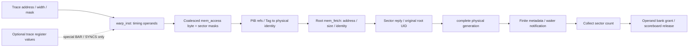

# SEM1 production value path and bounded bridge proposal

2026-10-19, original 174 account/container. **SOURCE_REVIEW_COMPLETE; PREPARED_NOT_TESTED; WAIT_AG4_TERMINAL_AUTHORITY.** This is a source and ABI finding, not a production value test result. No Core branch/library/binary is changed. The 90-minute source check began at 12:27 UTC; its bounded finding is published in this pack.

Production source: Core `c8090115bd57512b1b23fca7d925301fa620c751`; Framework decoder/parser `46df82670a56a4498b6d6e23ad57859eb7c36945`. References below are Git-object lines at those commits, not live worktree assumptions. Fixed older V2/Y2/X2/AG3 evidence is indexed in INPUT_EVIDENCE.md and consumed without rerunning it.

No arrow above carries general ordinary load/store bytes in the reviewed timing route. Optional trace fields exist; their capture coverage was not inspected here.

| Boundary | Actual production object/API and lines | Available | Exact missing interface |
|---|---|---|---|
| SASS load/store decode | Framework `gpu-simulator/trace-driven/trace_driven.cc:369-430`; `.h:65-75` | lane addresses, width, route, register IDs; global atomics set CACHE_GLOBAL, `should_do_atomic=false` | ordinary source-register bytes are not propagated into a store transaction; load register bytes are not computed |
| Optional values | Framework `gpu-simulator/trace-parser/trace_parser.h:81-107`; decoder references at 508-513 and 725-848 | schema `reg_src_vals/reg_dest_vals`; limited special-op consumers | no ordinary LDG/STG general value dataflow; actual capture coverage remains UNAVAILABLE |
| Coalescing | Core `src/abstract_hardware_model.h:1113-1231`; `.cc` `memory_coalescing_arch` | active lanes, width, byte and sector masks | no payload vector or byte-value API in mem_access_t |
| Accepted load route | Core `src/gpgpu-sim/shader.cc:3320-3394` | accepted reference / NEW_MISS identity; physical generation; lower candidate | per-consumer mapping from byte/lane output to physical bytes is not retained as a value-result contract |
| Lower root | `shader.cc:3396-3445`; `src/gpgpu-sim/mem_fetch.h:61-225` | root UID, original-root pointer, address, masks, size | `m_data_size` is traffic size, not data storage; mem_fetch has no ordinary byte payload buffer |
| Actual reply routing | `shader.cc:3457-3490` `dtc_l1_oo_consume_response` | expected/new sector check; identity/generation; complete after all expected sectors | before `delete mf`, no byte copy to a physical data array; supplied sector bytes have nowhere to go |
| Physical pool | `src/gpgpu-sim/dtc-l1-common.h:1013-1027` OO physical_line | ready/data_ready flags, allocation generation, Ref, waiter slot generations, notification times | no 128-byte physical data array; `data_ready` denotes return/metadata readiness, not stored bytes |
| Finite collection | `shader.cc:2961-2976`; common header `service_entry:78-112` | sector count and quota, collect times | no explicit `(consumer, physical generation, sector)` data-transfer cursor: `collect` only decrements `sectors_left` |
| Consumer result | `shader.cc:3492-3527`, `3529-3596` | operand-bank grant; pending-write decrement; scoreboard release; ledger retire | no load-result bytes, lane gather, or register-value commit to compare |
| Store / E / C / D | existing V2 route table R06-R15; current K1 remains source invalidate | route acceptance, sidecar and ACK counts, E/C/D can be separately identified | no W payload/publication/read-from contract; sidecar completion, ACK, fence or D cannot supply it |

## Consequences and smallest useful extension

A test that attaches expected bytes to the observer after completion would reproduce V2's external oracle gap. It is excluded. The prepared header `code/conditional_payload_bridge.h` instead owns **test-injected refill bytes only**, keyed by the production physical identity. It contains no expected-memory lookup and no reference-memory pointer. It may be called only from an isolated, default-OFF diagnostic Core with the following actual hooks:

1. Capture successful allocation and accepted per-consumer physical identity at actual `access` success. Capture root→physical identity at successful inflight insertion. Never predict acceptance from requests or names.
2. At `dtc_l1_oo_consume_response`, after real address/sector checks and before reply deletion, copy explicit fixture-owned 32-byte payload keyed to the accepted original-root UID. Missing fixture payload is a failure. A reply is never fabricated from the expected-memory oracle.
3. Record the exact sector transferred when actual collection quota commits. This requires a **diagnostic cursor** because the production service object presently stores only a count. Advance it once per quota commit, retaining it across WB rejection; snapshot physical generation before refs retire. Require actual consumer `entry_ready_for(uid)` and all-return conditions. Refuse an unnotified AD consumer even if another consumer is ready.
4. At successful operand-bank grant, emit collected byte observations keyed by dynamic instruction UID/lane/width/mask; compare against a separately maintained reference-memory snapshot outside the bridge. At physical release, erase bridge bytes only with production Ref=0. Preserve bytes through map loss, late merge, and WB rejection.

The header is **unbound preparation**. No production hook, cursor, fixture runner, ABI load, or tested binary exists yet; simply compiling or unit-testing it could not count as a production routing value test. A correct adapter and post-gate source review are prerequisites. The planned adapter must identify compiled Core source, actual dladdr loaded library, ELF ID/SHA, decoder/config, test-data injection and output sites, and zero functional-ISA/native claim. No script is executable or registered by this pack.

If connected and executed correctly, the narrow claim would be `CONDITIONAL_PRODUCTION_ROUTING_VALUE_TEST`: explicit bytes traverse actual allocation/return/collection/consumer routing under a fixture-defined visibility contract. It would still not validate real trace payloads, native CUDA arithmetic, SASS ISA, store propagation, cross-SM coherence, or K0 RAW correctness. Adding those requires capture-bound value dataflow or a functional ISA/memory model; this prep does not undertake that expansion.

K0's main configuration stays K0. Existing K1 can diagnose selected **source E** only, with old Ref/generation preserved; no new event source or per-store invalidation is proposed. AE affects Tag indexing; AD affects notification eligibility. Neither supplies missing payload or publication semantics.

The litmus table is a bounded plan, **not executable preregistration**: production adapter code, immutable fixture schedules (including the <=64 seed-generated schedules), exact compiler/ABI identities and command role registration remain to be fixed before first execution. Seed and limits alone do not license runtime dispatch. The matrix does not count repeated earlier pure-state cases as new value evidence.
