# GPU Memory Path Bottleneck Map

追加研究：`MEMORY_PATH_MLP_AND_BOTTLENECK_ATTRIBUTION_V1`，2026-10-26（Asia/Shanghai）。与 [Tag detach根因报告](ROOTCAUSE_REPORT.md) 共同构成单一结论：**维持现有T；不为非零detach修改保护，不自动追加模拟。** 本次未新建或重启Goal、controller或长期Lane。

## 已证实的三个主要约束：证据排序，不是可加的cycles归因

完整分层raw目前只对Vector r5与独立迁移Q2可读。CFD/DWT仍有接受的Tag压力投影，但不足以给出其全路径前三瓶颈。下列排序仅针对Vector r5；不得推广成三应用共同根因。

1. **PROVEN：下游服务与调度排队确实约束请求。LIKELY：是主要后端限制。** 32个DRAM channel的scheduler均到128项上限，时间平均占用96–107；full观察477774 channel-DRAM-cycle，占同一时钟域样本26.4978%。L2真实非空lower候选因scheduler且非return/credit被拒952167次。真实DRAM读写字节占本模型窗口容量77.8143%，不是100%链路饱和，也不证明扩大scheduler必然改善cycles。
2. **PROVEN：有限请求队列造成上游反压。** L1 miss queue重试1240787次；L2 missq每slice均曾到128，blocked观察818741次；L2 ingress满1546240 slice-L2-tick，占32.1966%。这是同一队列链可能重叠的压力，不能把三项相加当端到端停顿。L1 MSHR entry/merge失败为0，不能将其误叫L1 MSHR不足。
3. **PROVEN：核心供给受ready/依赖条件限制，另有EP局部服务等待。UNKNOWN：纯计算吞吐是否主导。** scheduler的W0_Scoreboard记录19626142次，resident occupancy87.136%仍不能保证可发射。这个计数包含“可能来自访存”的RAW依赖，不能全归给memory；bank landing109395、data service65277等局部head观察提供次级约束证据。没有同背景反事实，无法给它们排出独立cycles贡献。

这些是已观测的约束/症状，不是三个已证明可独立消除的性能瓶颈。最强的反例是：**低同set Tag压力与显著下游队列压力同时存在**，不能说“Tag不满，所以访存路径空闲”或“全GPU并发必然不足”。

## 路径与统计边界

```mermaid
flowchart LR
  SM[SM trace/寄存器依赖/warp调度] --> C[warp内合并成sector packet]
  C --> L1[L1 bank/latency queue/MSHR/missq]
  L1 --> X[LOCAL_XBAR packet仲裁]
  X --> I[L2 ingress/ROP]
  I --> E[Frontend/query/TVD/WAD]
  E --> T[Tag/RO合并/descriptor/payload]
  T --> Q[L2 MissQ/lower queue]
  Q --> D[DRAM latency/FR-FCFS/bank timing]
  D --> R[ReturnQ/RO landing bank]
  R --> X2[响应crossbar/SM buffer]
```

该生产runtime没有实际TLB/PTW阶段。ICNT是LOCAL_XBAR、packet单flit抽象，不是按真实字节链路带宽建模的NoC。详细代码和计数审计见 [L1/ICNT/TLB审计](L1_ICNT_TLB_MODEL_AND_COUNTER_AUDIT.md)。

## 已接受Vector r5逐层漏斗

精确身份：Core `1093d2629e3d6a9130ba25b9dd119b6f3e16c092`，main SHA `e511cce7d8bcd5a3ebbe6255f42ebe153547484a69c6857ab55f7a8835a2dc33`；Framework `9dd1ee57a83d83b56b7874bc7c716185ab52c8f7`。UUID `a6b61f77-2ff6-45ad-897c-df0812d01ae8`，75039 GPU cycles、56M thread instructions。下表均为同一接受raw，未拼接其它binary。

|层次|计数/率/延迟|占用与block|解释|
|---|---|---|---|
|Warp memory instruction|专门按warp的memory指令数UNKNOWN；lane load8M、store4M；总warp指令统计2M|W0_Scoreboard19626142、Stall668244、Idle102202|分布计数为scheduler观察，不是全GPU独占cycles；总warp指令与W32分布计数不可强行互换|
|Coalesced/injected global packets|read1M、write500k；共1.5M；约19.9896 packet/GPUcycle|coal_stall0|平均8个thread load/store事件对应1个sector请求；不能叫1M warp loads或1M独立line|
|L1 accesses/misses|1.5M/1.5M，实际观测100%miss|missq full1240787重试，约0.82719次/accepted access；bank latency queue冲突122492；MSHR entry/merge/line alloc fail0|未见高L1命中屏蔽流量；重试比不是wall-cycle概率；L1实际outstanding均值/峰与完整merge分布UNKNOWN|
|ICNT request injection|接受1.5M packets；conflicts7.6666/GPUcycle|input-full0；output-full0.0029/cycle；input queue均值6.3005、output51.9105 packets|avg_util是队列包数，不是%；没有offered unique请求计数，不能反推独立注入拒绝概率|
|L2 ingress|独立offered/accepted事件流UNKNOWN；观察满率32.1966% slice-L2-tick|1546240次满容量检查，可能无ICNT head|计数名gpu_stall_dramfull不代表DRAM直接full|
|L2 Frontend到commit|FT attempts1581555；实际commit accepted1500000、denied81555（尝试拒绝率5.1566%）|denied_bank65277、denied_landing16278；其余commit拒绝项0|r5 route admitted标志代表Frontend放行一次commit尝试，**不等于commit成功**|
|L2 cache传统统计|750118 accesses/misses；pending hit0、reservation fail0|RO MSHR_HIT另有749882|传统统计不含该merge人口，不能用100%miss否定合并|
|RO line事务|1M accepted RO请求→250118事务＋749882merge；74.9882%请求merge，3.99811请求/事务|live transaction峰每slice90–96，issued-not-ready独立line峰63–70|不同sector共用line身份；没有减少本例1M sector DRAM读包|
|L2 Tag|covered newTag head915784；newTag且eligible2385；生产FAIL/relieve/detach0|B0全set tick末每slice总RESERVED峰90–96，任一set峰均3/16|并发和空间分散存在；平均到达率及Tag生存期按单set仍UNKNOWN|
|L2内部queue/bank|missq full818741 slice-head观察；scheduler causal拒绝952167|missq均值21–93/峰128；lowerq均值52–99/峰128；bank请求2992366/grant2600762/wait391604|queue或bank不等于Tag资源；block事件和不同层的等待不能相加|
|L2 lower / DRAM issue|read1M packets/32MB；write100762 packets/12897536B|scheduler均值96–107/128、全channel峰128|成功issue不是单独测量的completed-response计数|
|DRAM completed responses|独立统一完成计数UNKNOWN；已有drain、RO fill/response与写回闭合支持成功请求最终结束|returnq每channelavg0/max1/full0；gpu_stall_icnt2sh0|不把下游issue直接改名completed，也不把RO requester response和sector return当同单位|
|端到端memory latency|mf avg1266/max3970；icnt2mem234/max1856；mrq228/max2517；icnt2sh7/max213，corecycle计时|不同population、嵌套起止区间|不能求1266−234−228−7作为L2服务时间；都不是Tag RESERVED lifetime|

raw主要位置：总量29366–29374；L1 29470–29477；core/traffic/latency29579–29625；DRAM最后32行分布29910–39582；B0最后64行29974–39765；ROC1 30022–39816；L2 39952–39956；ICNT40041–40064。[CSV](UPSTREAM_TO_L2_MLP_FUNNEL.csv) 给出每项单位、分母、scope及每slice摘要；[JSON](MEMORY_PATH_EVIDENCE.json)保存所选raw行号、SHA和64slice数据。

## 哪些资源没有表现出实际饱和

**PROVEN（Vector精确观测）**：Tag all-reserved block/TagFAIL/detach为0；descriptor峰344–369<512且full block0；L1 MSHR entry/merge fail0；DRAM returnq-full0；L2回SM注入full计数0；RO query port wait attempts0。M-ON的RO line-MSHR使用0主要由旁路策略导致，**不能说“128个line MSHR实测富余”**。L1 offered outstanding、真实NoC链路、TLB/PTW不在可用饱和结论范围。

query每请求一cycle等待合计1M，证明固定建模延迟；port-wait0不支持query端口吞吐饱和。payload bank有真实竞争，平均总grant相对名义全bank时隙很低也不能证明各局部时刻不饱和；不以全窗口均值掩盖局部争用。

## Tag机会与性能机会

每slice实际RO lower独立line峰63–70、总RESERVED峰90–96；这些数字不能跨slice相加成同刻GPU峰，也不能把某slice的峰平均摊给64set后算TagFAIL概率。额外全set tick采样的上界3结合总峰90–96，能严格推出：各slice的总峰时刻至少30–32个不同set同时含RESERVED Tag。这是空间分散的下界，不是均匀分布假设。

当前T释放的是Tag绑定，不释放旧RO payload、descriptor、lower服务或响应工作。上述接受条件下没有可救的实际TagFAIL；新Tag与16路RESERVED的r5实际联合为0。即使人为增加同set压力，后端已排队也可能让detach仅转移等待而不降cycles。真实硬件机会、其它输入和tick内瞬态仍UNKNOWN。

## 数据身份与缺口

- Vector raw SHA：`1f5519151cb381fbc370591d65e7ad78691435d5955ad99fea8dcdf7ffab0f6a`，8593124B。config0/1/2/3 SHA完整值存JSON。按命令顺序覆盖后的actual config：L1 4banks/20cycle、MSHR512/merge8/MissQ16；L2 64sets×16ways×128B、64slices、MissQ128、descriptor512、RO-M旁路；32DRAMchannel、FR-FCFS128、return192；1132/1132/1132/850MHz。
- 原生迁移Q2是独立已接受main61 S背景，73696cycles、56M指令，raw SHA `a7d18107f4640784465480b8ffeaf0a2c1d70b4d9c8a99b37ece862ac310716a`。同为1.5M L1 misses、相同注入packet工作量，DRAM byte利用率79.1879%；它不是原E013 raw，也不是r5的同binary性能对。没有计算跨binary加速或局部因果差值。
- CFD E056、DWT E057逐层raw在本轮审核的批准本地roots未找到。DWT旧restore证明只能证明历史曾恢复；今天该目录没有raw，sidecar仅configs/NATIVE_EXIT。保持既有r5 Tag投影，不新搬运/恢复，不访问正在迁移或GPU109采集的数据。其L1/ICNT/DRAM分层瓶颈及Tag寿命均UNKNOWN。
- 原MAIN配对数字仍由原表保存；没有把Q2或r5输出假冒配对某端。源数据KEEP，旧57/44/T0与预算不变。

## 本轮执行与单一建议

实际执行了受限只读解析与SHA验证，最后脚本0.202s，30s timeout、nice10、单CPU；[审计脚本](audit_memory_path_evidence.py)不导入simulator、不改生产源码。两份raw约12.9MB；去掉重复累计打印，64slice、32channel、最终周期及加权容量闭合通过。历史fixtures只读，未运行新模拟、编译、恢复、trace采集或资产迁移。

需要补的最小信息是同步的slice/set新Tag接受事件、RESERVED进入/退出时间及真实门禁原因；设计与非干扰检查见 [最小受控实验计划](MINIMAL_CONTROLLED_EXPERIMENT_PLAN.md)。优先两个未来实验候选为DRAM服务敏感性、L1 missq容量单因素控制；均未安排或执行，需新的精确授权/预算/native资格。它们不是为获取非零detach而设计。

**统一科学建议：维持T并收紧论文中的独立应用收益声明。当前支持的是“访存路径有其它有限资源压力，但未出现不可替换Tag压力”，不支持“全GPU没有MLP”、TLB瓶颈、真实NoC带宽瓶颈，或T已有端到端收益。**
